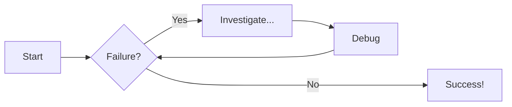
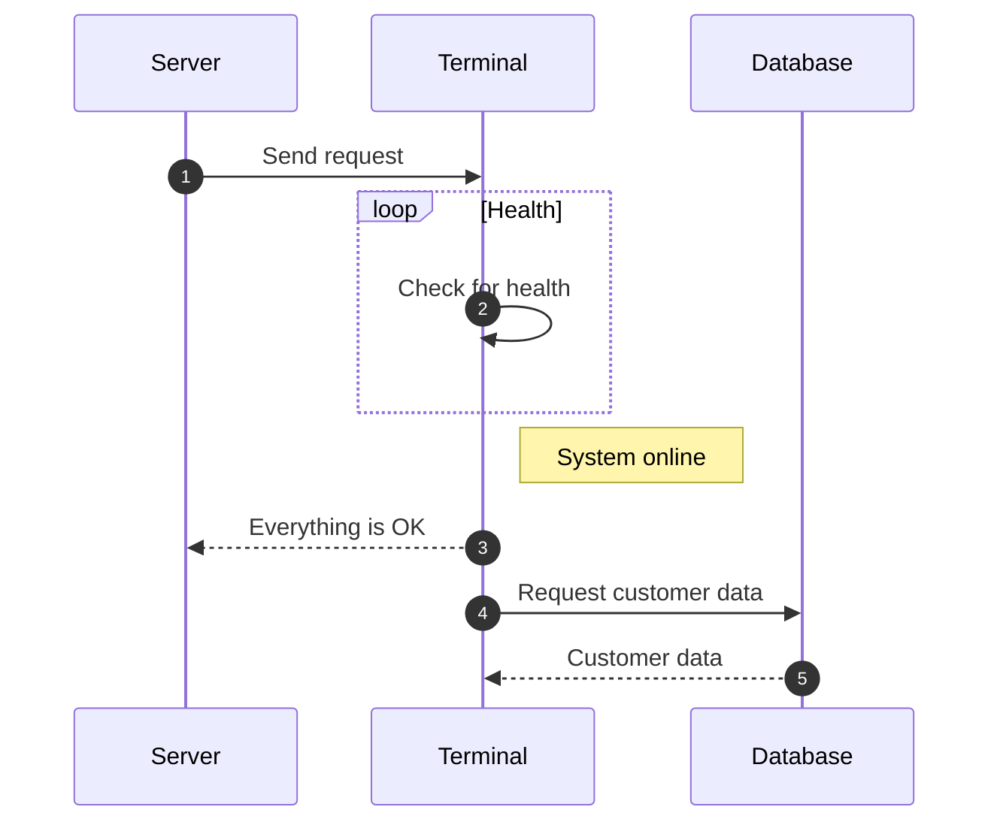

# Contributing
This page is for contributors for this website.

Check out the source code to learn how each piece is made

For full documentation visit [mkdocs.org](https://www.mkdocs.org).

## Code Snippets

```java title="Example Java code" linenums="1" hl_lines="3-4"
// This is an example of Jave code with line numbers and lines 3-4 highlighted
int teamNum = 422
if (teamNum==422) {
    System.out.println("This is team 422");
}
else {
    System.out.println("This is not team 422");
}
```

## Content Tabs
=== "Plain Text"
    Use the bars above to navigate
=== "Unordered List"
    * First
    * Second
    * Third
=== "Ordered List"
    1. First
    2. Second
    3. Third

## Code With Content Tabs
=== "Java"
    ```java
    int teamNum = 422
    System.out.println(teamNum + " wins worlds!");
    ```
=== "Python"
    ```py
    teamNum=422
    print(teamNum +" wins worlds!")
    ```
## Admonitions (ie Callouts)
### Regular
!!! note "Important Note"
    The class name MUST match the name of the file for your code to run.
### Collapsible
???+ info "Collapsible Note"
    If you are missing the run code button, make sure your file is saved!
### Different Icon
??? question "Want more icons?"
    Visit [this link](https://squidfunk.github.io/mkdocs-material/reference/admonitions/?h=adm#supported-types) to find the list of supported icons.

## Diagrams
### Flowcharts



### Sequence Diagrams



## Interactive Code Editors

Two kinds of fenced blocks turn into live widgets. Both are plain Markdown, so there is nothing to build or install. The code that runs them lives in `docs/javascripts/` (`minijava.js` is a small Java interpreter, `wpilib-prelude.js` is a pretend WPILib, and `playground.js` makes the widgets).

### Playground

A `playground` block is an editable Java program with a __Run__ button. Lines starting with `//@` set options and must come before the code.

````text
```playground
//@ title: Change a member
//@ goal: Press Run, then change the message.
String message = "hello world";
System.out.println(message);
```
````

To make it a graded challenge, add a hidden test below the starter code. The student's code is checked when they press __Check my code__.

````text
```playground
//@ title: Write a method
//@ goal: Write a method named doubleIt that returns number * 2.
//@ require: int\s+doubleIt\s*\( | Name the method doubleIt and return an int.
// Write your method here:

//@@ harness
System.out.println(doubleIt(4));
//@@ expect
8
//@@ hint
The header looks like `public int doubleIt(int number)`.
//@@ solution
public int doubleIt(int number) {
    return number * 2;
}
//@@ explain
Shown after the student passes.
```
````

| Line | Meaning |
|---|---|
| `//@ title:` / `//@ goal:` | Heading and instructions above the editor |
| `//@ require: regex \| message` | The code must match the pattern, otherwise the message is shown |
| `//@ mode: predict` | Student predicts the output instead of writing code |
| `//@ prelude: wpilib` | Loads the pretend WPILib (no `import` needed) |
| `//@ panel: robot` | Shows the robot simulator and virtual controller |
| `//@@ harness` | Hidden code appended when checking |
| `//@@ expect` | Exact output the check must produce |
| `//@@ hint` | Repeatable. Revealed one at a time |
| `//@@ solution` | Shown after a failed check |
| `//@@ explain` | Shown after the challenge is passed |

### Quiz

````text
```quiz
@ title: Members or methods?
? `int numLegs;`
- Member
- Method
+ Member
> Shown after answering.
```
````

`?` starts a question, `+` marks a correct answer (use several for "pick all that apply") and `>` is the explanation.

### Checking your work

Broken exercises are easy to write by accident, such as a solution that doesn't pass its own test. Before opening a pull request, run:

```bash
node tools/check-lessons.js
```

It runs every playground and quiz on the site and checks that each starter fails, each solution passes, and every quiz question has a correct answer. `node tools/test-minijava.js` and `node tools/test-wpilib.js` test the interpreter and the pretend WPILib. CI runs all three before deploying.

!!! note "Students' progress"
    Progress is saved in each student's own browser, so it stays on their device and can be cleared by them.
