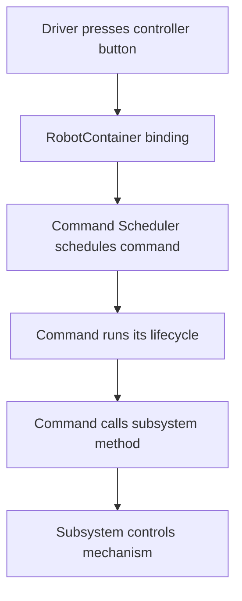

# How an FRC Robot Program Fits Together

Before writing commands or controlling a motor, learn the job of each major file in a WPILib **Command-Based** robot project. This lesson uses the standard command-based structure. If your team uses a different architecture, the same separation-of-responsibilities ideas still apply.

## The four pieces to recognize

| Piece | Main responsibility |
|---|---|
| `Robot.java` | Starts the robot program and runs WPILib's command scheduler at the appropriate time. |
| `RobotContainer.java` | Creates subsystems and commands, and connects controller inputs to actions. |
| A subsystem, such as `ShooterSubsystem.java` | Owns a mechanism's hardware and provides methods that control or report its state. |
| A command, such as `ShootCommand.java` | Describes an action, including when it starts, what it does while running, and when it ends. |

A useful mental model is: **the controller requests an action, the command coordinates it, and the subsystem operates the mechanism.**

## Explore the flow

The buttons below are a small conceptual model. They don't connect to a physical robot or run WPILib; they let you inspect the sequence of events a command-based program would follow.

  <h3>Controller → Command → Subsystem</h3>
  
Try pressing the shooter button. If you choose a hold-to-run control, press it once to start and again to release it.

  

    <button type="button" data-controller-action="A button" data-command="ShootCommand" data-mode="onTrue">Tap A: run once</button>
    <button type="button" data-controller-action="Right trigger" data-command="ShootCommand" data-mode="whileTrue" aria-pressed="false">Hold trigger: start/stop</button>
    <button type="button" data-controller-action="B button" data-command="ShootCommand" data-mode="toggle" aria-pressed="false">B: toggle command</button>
  

  
<strong>Event trace</strong>

  <pre class="frc-lab__output" data-container-output aria-live="polite">Choose a controller input to see the conceptual event trace.</pre>
  
Important: these buttons demonstrate the idea, not the full timing behavior of the WPILib scheduler. In real code, command bindings are configured in RobotContainer.

## What actually happens in the code?

In a typical command-based WPILib project:

1. WPILib creates your `Robot` and `RobotContainer`.
2. `RobotContainer` creates subsystem objects and configures controller bindings.
3. The scheduler checks registered button conditions and runs scheduled commands.
4. A command calls methods on the subsystem it requires.
5. The command ends or is interrupted, and its end behavior runs.

The scheduler runs repeatedly; it is not started only when a button is pressed. That recurring execution is why a command can keep doing work while a button is held.

## Check your understanding

  <h3>Which class should own the motor controller for a shooter?</h3>
  

    <button type="button" data-answer="wrong">RobotContainer</button>
    <button type="button" data-answer="correct">ShooterSubsystem</button>
    <button type="button" data-answer="wrong">The controller button</button>
  

  
Choose an answer to see feedback.

  <h3>Where would you normally connect a controller button to a command?</h3>
  

    <button type="button" data-answer="correct">RobotContainer</button>
    <button type="button" data-answer="wrong">Inside the motor's periodic method</button>
    <button type="button" data-answer="wrong">Inside every method in the subsystem</button>
  

  
Choose an answer to see feedback.

## Next: build a subsystem

Now that you know how the pieces relate, continue to [Subsystems: representing a mechanism](subsystems.md). You'll experiment with a shooter subsystem's public methods and see why hardware details belong inside the subsystem.
