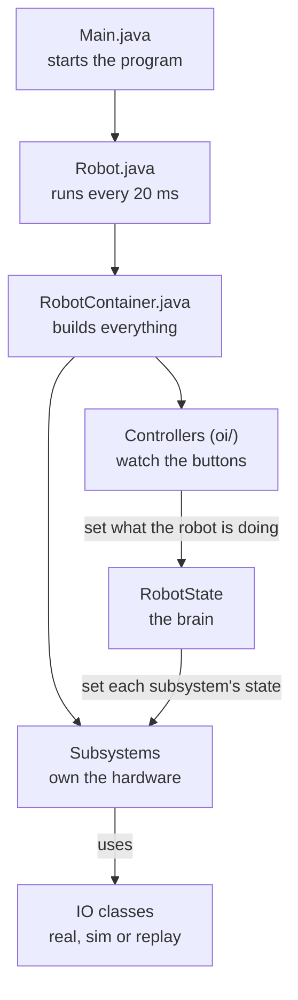

# FRC Nuances

You now know enough Java to read most robot code. This page covers what is __different__ about programming a robot, and the handful of Java features that show up in every FRC project but that a normal Java course barely touches.

Everything with a code editor on this page runs right in your browser. It isn't the real WPILib, but it is a pretend version with the same class names and the same shape, so what you write here is what you'd write on the robot.

!!! note "About the simulator"
    The in-browser robot understands a small slice of WPILib: subsystems, commands, triggers, the scheduler, Xbox controllers, a motor controller, and `DifferentialDrive`. You don't need `import` lines in the editors on this site. Real projects do, and the sections below show them.

!!! info "Our way of writing robot code"
    If you search for FRC tutorials, you'll find many that put commands inside every subsystem. Our team does it differently. Each mechanism is split into small, swappable layers, and the whole robot is driven by __states__. That structure comes from the code we actually run, and the next few pages teach it. When something here looks different from an online tutorial, this is why.

## Your code doesn't run top to bottom

In the Java lessons, your program ran from the first line to the last and then stopped. A robot program is different. It starts, and then WPILib calls your code over and over, __50 times every second__ (once every 20 milliseconds), until the robot is switched off. You don't write that loop. You write the pieces WPILib calls, and WPILib decides when.

Which pieces get called depends on what mode the robot is in, which the Driver Station controls:

| Mode | Runs once when it starts | Runs every 20 ms |
|---|---|---|
| Any | `robotInit()` (at startup) | `robotPeriodic()` |
| Disabled | `disabledInit()` | `disabledPeriodic()` |
| Autonomous | `autonomousInit()` | `autonomousPeriodic()` |
| Teleop | `teleopInit()` | `teleopPeriodic()` |

Once the robot is on, press the buttons to switch modes and watch the counter. The dashboard on the right is `SmartDashboard`, which is how robot code shows numbers to the drivers.

```playground
//@ title: The 20 ms loop
//@ panel: robot
//@ show: dashboard
//@ goal: Press Run, then switch the robot between disabled, auto and teleop. Only teleop makes this counter move. Try changing teleopPeriodic to autonomousPeriodic.
//@ lines: 14
public class Robot extends TimedRobot {
    private int m_ticks = 0;

    @Override
    public void teleopPeriodic() {
        m_ticks++;
        SmartDashboard.putNumber("Loop count", m_ticks);
        SmartDashboard.putNumber("Seconds", m_ticks / 50.0);
    }
}
```

Now see if you can predict the order WPILib calls things in. Read it carefully, because `robotPeriodic()` is easy to get wrong.

```playground
//@ title: What order do things run in?
//@ mode: predict
//@ prelude: wpilib
//@ goal: This starts the robot, switches to teleop, and runs 2 loops. Type the 6 lines it prints.
//@ lines: 18
public class Robot extends TimedRobot {
    @Override public void robotInit()      { System.out.println("robotInit"); }
    @Override public void teleopInit()     { System.out.println("teleopInit"); }
    @Override public void teleopPeriodic() { System.out.println("teleopPeriodic"); }
    @Override public void robotPeriodic()  { System.out.println("robotPeriodic"); }
}

Sim.start(new Robot());
Sim.setMode("teleop");
Sim.loops(2);
//@@ explain
The `Init` methods run once. After that, each loop calls the mode's periodic method first and `robotPeriodic()` second. Two loops means two of each pair.
```

!!! tip "Why 20 ms matters"
    Your periodic code has to finish well inside 20 ms. Don't put loops that wait, sleep, or take a long time in there. If your code is slow, the whole robot gets sluggish. This is also why we avoid `Thread.sleep` in robot code.

## The files in a robot project

When WPILib creates a project for you, your code lives in `src/main/java/frc/robot`. Here is how our team's robot code is organized.

```text title="Our project layout"
src/main/java/frc/
├── robot/
│   ├── Main.java             Starts the program. Never edit this.
│   ├── Robot.java            The modes. Also sets up logging.
│   ├── RobotContainer.java   Creates every subsystem and controller, connects buttons.
│   ├── RobotState.java       The robot's "brain": what is it trying to do right now?
│   ├── Constants.java        Numbers that belong in one place: CAN IDs, speeds, tuning.
│   ├── subsystems/           One folder per mechanism.
│   │   ├── drive/
│   │   │   └── Drive.java    The drivetrain, plus IO classes for its gyro and swerve modules.
│   │   └── intake/
│   │       ├── Intake.java               The subsystem: its states and its logic.
│   │       ├── pivot/                    The arm that swings the intake out.
│   │       │   ├── PivotIO.java          The list of things the hardware can do.
│   │       │   ├── PivotIOKraken.java    Talks to the real motors.
│   │       │   ├── PivotIOSim.java       A pretend pivot for simulation.
│   │       │   └── PivotIOReplay.java    Does nothing, used when replaying a log.
│   │       └── roller/                   The wheels that grab the game piece. The same
│   │                                     four files: IntakeRollerIO, IntakeRollerIOKraken,
│   │                                     IntakeRollerIOSim, IntakeRollerIOReplay.
│   ├── oi/                   Controller classes: which button means what.
│   ├── commands/             Only drive commands and autonomous routines.
│   └── util/                 Helpers shared by everything.
└── lib/                      Code we borrowed from other teams and libraries.
```



You will spend most of your time in these places:

- __Subsystems__ run one mechanism as a set of states, and talk to hardware only through an IO class. See [Subsystems](subsystems.md).
- __RobotContainer__ builds everything and connects buttons. See [RobotContainer](robotContainer.md).
- __RobotState__ decides what the whole robot is doing, and tells each subsystem. See [RobotState](robotState.md).
- __Constants__ holds every number you might need to change. See [Constants](constants.md).

`Robot.java` stays mostly as it is. Our robot `extends LoggedRobot` instead of the usual `TimedRobot`. A `LoggedRobot` is a `TimedRobot` that also records everything the robot does into a log file, which we can replay later on a laptop. The part that matters is in `robotPeriodic()`:

```java title="Robot.java"
@Override
public void robotPeriodic() {
    RobotState.getInstance().updateRobotState();
    CommandScheduler.getInstance().run();
}
```

Every 20 ms, `RobotState` decides what the robot should be doing, and then the __command scheduler__ polls the buttons, runs any active commands and calls every subsystem's `periodic()` method. The scheduler is still the engine that keeps everything ticking. If you delete that one line, the robot does nothing.

```quiz
@ title: Which file?
? You want to change which CAN ID the intake motor uses. Where is the best place?
- `Main.java`
- `Robot.java`
+ `Constants.java`
- `RobotContainer.java`
> Numbers like CAN IDs live in `Constants.java` so you can find and change them in one place.

? You want the A button to start the intake. Where does that binding go?
- `Main.java`
- `IntakeSubsystem.java`
+ `RobotContainer.java`
- `Constants.java`
> `RobotContainer` connects controller buttons to commands.

? You want the whole robot to switch into "intaking" mode when the driver presses a button. Which file keeps track of what the robot is doing?
- `Main.java`
- `Constants.java`
+ `RobotState.java`
- `ElevatorIOSim.java`
> `RobotState` is the robot's brain. It remembers the current action and tells each subsystem what to do.

? Which class talks to the real motors on the elevator?
- `Elevator`
- `ElevatorIO`
+ `ElevatorIOKraken`
- `ElevatorIOSim`
> `ElevatorIOKraken` is the only one that touches real hardware. `Elevator` only ever talks to the `ElevatorIO` interface.

? Which file should you never edit?
+ `Main.java`
- `Robot.java`
- `Constants.java`
- `RobotContainer.java`
> WPILib handles `Main.java`. It just starts your robot.

? Which line in `robotPeriodic()` calls every subsystem's `periodic()` method?
- `SmartDashboard.updateValues();`
+ `CommandScheduler.getInstance().run();`
- `RobotContainer.run();`
- `super.periodic();`
> The scheduler polls buttons, runs commands and calls subsystem `periodic()` methods.
```

## Java you will see in every robot project

These are the Java features that robot code leans on. Most of them you have partly seen already.

### `package` and `import`

Every file in a real project begins with a `package` line, which says which folder it lives in, and `import` lines, which tell Java where to find the classes you use. WPILib and vendor libraries each have their own.

```java title="IntakeSubsystem.java"
package frc.robot.subsystems;

import com.revrobotics.spark.SparkLowLevel.MotorType;
import com.revrobotics.spark.SparkMax;
import edu.wpi.first.wpilibj2.command.SubsystemBase;
```

You almost never type these by hand. VS Code underlines a class it can't find in red. Click it and choose the quick fix __Import__, or press `Ctrl` + `.` (`Cmd` + `.` on a Mac) while your cursor is on it. The editors on this site skip imports so you can focus on the code.

### `extends`: inheriting from a class

When a class `extends` another, it automatically gets everything the other class has. Almost everything in command-based programming is built this way. Your subsystem `extends SubsystemBase`, so it inherits what makes it a subsystem.

Here is the powerful part. `SubsystemBase` registers every subsystem with the scheduler when it's created, and the scheduler calls each one's `periodic()` method every loop. You never call `periodic()` yourself. Run it and watch.

```playground
//@ title: periodic() is called for you
//@ prelude: wpilib
//@ goal: Run it. Notice that nothing in the code calls periodic(). Then add a second subsystem called Intake that prints its own message.
//@ lines: 14
public class Arm extends SubsystemBase {
    @Override
    public void periodic() {
        System.out.println("Arm periodic");
    }
}

Arm arm = new Arm();

// This is what Robot.java does for you every 20 ms:
CommandScheduler.getInstance().run();
CommandScheduler.getInstance().run();
CommandScheduler.getInstance().run();
```

Now try it yourself. This class has the right method but forgot to extend anything, so the scheduler has no idea it exists.

```playground
//@ title: Make Arm a subsystem
//@ prelude: wpilib
//@ goal: Make Arm a real subsystem so the scheduler calls its periodic() method.
//@ lines: 10
//@ require: extends\s+SubsystemBase | Make Arm extend SubsystemBase.
//@ require: @Override | Mark periodic() with @Override.
public class Arm {
    public void periodic() {
        System.out.println("Arm is alive");
    }
}
//@@ harness
Arm arm = new Arm();
CommandScheduler.getInstance().run();
CommandScheduler.getInstance().run();
//@@ expect
Arm is alive
Arm is alive
//@@ hint
Add `extends SubsystemBase` after the class name.
//@@ hint
Put `@Override` on its own line above `public void periodic()`. This tells Java that you are replacing a method from the parent class.
//@@ solution
public class Arm extends SubsystemBase {
    @Override
    public void periodic() {
        System.out.println("Arm is alive");
    }
}
//@@ explain
`SubsystemBase` does the registering for you. All you do is override `periodic()` with what you want to happen each loop.
```

### `@Override`

`@Override` is a promise to Java: "this method replaces one from the parent class." If you spell it wrong or give it the wrong inputs, Java stops you, instead of silently never calling it. Without `@Override`, a typo like `periodc()` is just a new method that nobody calls, and you'd spend an hour wondering why nothing happens.

```playground
//@ title: The typo that @Override catches
//@ prelude: wpilib
//@ goal: Press Run and read the error message. Fix the typo, then press Check my code.
//@ lines: 8
public class Arm extends SubsystemBase {
    @Override
    public void periodc() {
        System.out.println("Arm periodic");
    }
}
//@@ harness
Arm arm = new Arm();
CommandScheduler.getInstance().run();
//@@ expect
Arm periodic
//@@ hint
Look closely at the method name. Compare it to `periodic`.
//@@ solution
public class Arm extends SubsystemBase {
    @Override
    public void periodic() {
        System.out.println("Arm periodic");
    }
}
//@@ explain
"Method does not override or implement a method from a supertype" always means one thing: the name or inputs don't match the parent's method. Always add `@Override`, and let Java catch typos for you.
```

### `final`, `static`, and constants

You'll see these everywhere, usually together.

- `final` means the variable can never be reassigned after it's set. A motor controller is created once and never swapped out, so we write `private final SparkMax m_motor`.
- `static` means the thing belongs to the class itself, not to each object. So no matter how many objects of a class you make, changing a static variable for one of them changes it for all the objects at the same time. It also means you can use it without creating an object at all, like `Math.abs(x)` or `Constants.kMaxSpeed`.
- A `static final` value is a __constant__: one fixed number that lives in one place.

WPILib teams, including ours, follow two naming habits, and you'll see them in every project:

| Convention | Used for | Example |
|---|---|---|
| `m_` prefix | Member fields of an object | `m_motor`, `m_driverController` |
| `k` prefix | Constants | `kMotorId`, `kIntakeSpeed` |

Robot constants live in `Constants.java`, grouped into small nested classes so related numbers stay together.

```playground
//@ title: A Constants file
//@ goal: Run it. Then change kIntakeSpeed and add a new constant of your own, like kOuttakeSpeed, and print it.
//@ lines: 18
public class Constants {
    public static final class IntakeConstants {
        public static final int kMotorId = 5;
        public static final double kIntakeSpeed = 0.8;
    }

    public static final class DriveConstants {
        public static final int kLeftMotorId = 1;
        public static final int kRightMotorId = 2;
    }
}

System.out.println("Intake motor on CAN id " + Constants.IntakeConstants.kMotorId);
System.out.println("Intake speed " + Constants.IntakeConstants.kIntakeSpeed);
System.out.println("Left drive motor on CAN id " + Constants.DriveConstants.kLeftMotorId);
```

```playground
//@ title: Add constants
//@ goal: Inside ArmConstants, add two constants: an int called kMotorId set to 9, and a double called kMaxSpeed set to 0.4.
//@ lines: 12
//@ require: static\s+final\s+int\s+kMotorId | Declare kMotorId as public static final int.
//@ require: static\s+final\s+double\s+kMaxSpeed | Declare kMaxSpeed as public static final double.
public class Constants {
    public static final class ArmConstants {
        // Add your constants here

    }
}
//@@ harness
System.out.println(Constants.ArmConstants.kMotorId);
System.out.println(Constants.ArmConstants.kMaxSpeed);
//@@ expect
9
0.4
//@@ hint
The pattern is `public static final type kName = value;`
//@@ solution
public class Constants {
    public static final class ArmConstants {
        public static final int kMotorId = 9;
        public static final double kMaxSpeed = 0.4;
    }
}
//@@ explain
If the arm motor ever changes CAN id, you fix it in exactly one place, and every file that uses `kMotorId` picks up the change.
```

```quiz
@ title: final and static
? What does `private final SparkMax m_motor;` mean?
- The motor can only be used once
+ The variable `m_motor` can't be pointed at a different motor after it's set
- The motor is faster than a regular one
- The motor is shared by all robots
> `final` locks the variable so it can't be reassigned.

? How would you read a constant `kMaxSpeed` inside `Constants.DriveConstants` from another class?
- `new DriveConstants().kMaxSpeed`
+ `Constants.DriveConstants.kMaxSpeed`
- `kMaxSpeed.DriveConstants.Constants`
- `Constants(DriveConstants).kMaxSpeed`
> Static members belong to the class, so you reach them through the class name with no `new` needed.

? Which name follows WPILib conventions for a field holding a motor?
- `Motor`
+ `m_motor`
- `kMotor`
- `MOTOR_`
> `m_` is for member fields, and `k` is for constants.
```

### Lambdas: code you hand to someone else

A __lambda__ is a method with no name that you can store in a variable and pass around. It's written `() -> something`. The `()` holds any inputs, and the arrow points to the code to run.

This matters in FRC because you often want to say "do this, but not right now, do it when the driver presses a button." Passing `m_motor.set(0.5)` directly would run it immediately, when the code is read. Wrapping it as `() -> m_motor.set(0.5)` gives the scheduler a package to run later.

Lambdas are mainly used in button bindings, where Java expects a `runnable`, and passing it a method with a parameter instead will confuse it.

```playground
//@ title: Running code later
//@ goal: Run it. The counter only changes when run() is called, not when the lambda is created. Add a third call to run().
//@ lines: 12
public class Counter {
    public int value = 0;
}

Counter counter = new Counter();
Runnable addOne = () -> counter.value++;

System.out.println("Before: " + counter.value);
addOne.run();
addOne.run();
System.out.println("After: " + counter.value);
```

A lambda that gives something back is called a __supplier__. `DoubleSupplier` gives back a `double`, and `BooleanSupplier` gives back a `boolean`. Joystick values are a classic use. Pushing the stick changes the value, so you can't just read it once. You pass a supplier that reads it fresh each time.

```playground
//@ title: A snapshot vs a live value
//@ mode: predict
//@ goal: What do the two lines print?
//@ lines: 12
public class Joystick {
    public double y = 0.0;
}

Joystick stick = new Joystick();

double snapshot = stick.y;            // reads the value once, right now
DoubleSupplier live = () -> stick.y;  // reads the value every time it's asked

stick.y = 0.8;

System.out.println("snapshot: " + snapshot);
System.out.println("live: " + live.getAsDouble());
//@@ explain
`snapshot` was copied while the stick was still at 0.0 and never changes. The lambda `live` looks at the stick when asked, so it sees 0.8. This is exactly why drive commands take `() -> controller.getLeftY()` instead of `controller.getLeftY()`.
```

Finally, you'll sometimes see `this::method` or `m_intake::isReady`. That's a __method reference__, shorthand for a lambda that does nothing but call that method: `m_intake::isReady` means the same as `() -> m_intake.isReady()`.

```quiz
@ title: Lambdas
? What does `() -> m_motor.set(0.5)` do when Java reaches it?
- Sets the motor to 0.5 immediately
+ Creates a package of code to be run later, without running it yet
- Throws an error
- Sets the motor to 0.5 for 20 ms
> A lambda is just code waiting to be run. Calling it (or having the scheduler call it) is what runs it.

? Which one passes a __live__ joystick reading to a drive command?
- `controller.getLeftY()`
+ `() -> controller.getLeftY()`
- `getLeftY`
- `controller.getLeftY`
> The lambda is a `DoubleSupplier` that gets asked for the latest value every loop.

? `m_intake::isReady` is shorthand for which lambda?
- `() -> m_intake`
+ `() -> m_intake.isReady()`
- `m_intake -> isReady`
- `() -> isReady`
> A method reference is a shortcut for a lambda that only calls that method.
```

### Interfaces: a promise about what a class can do

An __interface__ is a list of methods with no code inside them. A class that `implements` the interface promises to write every one of those methods. Anything that wants to use the class only has to know about the interface, not which class is behind it.

This solves a real robot problem. The same mechanism has to work in three places: on the robot (talking to a real motor), in simulation (a pretend motor), and when we replay a match log on a laptop (no motor at all). So we write one interface for the mechanism, then one class per place.

```playground
//@ title: One interface, two classes
//@ goal: Run it. Then change the single line that says new ShooterIOSim() to new ShooterIOReal() and run it again. Only that one line changes, but the behavior does.
//@ lines: 22
public interface ShooterIO {
    void setVoltage(double volts);
}

public class ShooterIOReal implements ShooterIO {
    @Override
    public void setVoltage(double volts) {
        System.out.println("Real motor spinning at " + volts + " V");
    }
}

public class ShooterIOSim implements ShooterIO {
    @Override
    public void setVoltage(double volts) {
        System.out.println("Pretend motor spinning at " + volts + " V");
    }
}

ShooterIO io = new ShooterIOSim();
io.setVoltage(6.0);
```

Look at the variable's type. It's `ShooterIO`, the promise, not `ShooterIOSim`, the actual class. That's what lets you swap one class for another without changing any code that uses `io`. A subsystem holds a `ShooterIO` and never knows or cares which one it was given.

Now write one yourself. When we replay a log, the data comes from the file, so there is no hardware to command. The replay class implements every method and does nothing.

```playground
//@ title: Write the replay class
//@ goal: Add a class named ShooterIOReplay that implements ShooterIO. Its setVoltage method should do nothing at all.
//@ lines: 18
//@ require: class\s+ShooterIOReplay\s+implements\s+ShooterIO | Declare class ShooterIOReplay implements ShooterIO.
//@ require: @Override | Mark setVoltage with @Override.
public interface ShooterIO {
    void setVoltage(double volts);
}

public class ShooterIOSim implements ShooterIO {
    @Override
    public void setVoltage(double volts) {
        System.out.println("Pretend motor spinning at " + volts + " V");
    }
}

// Write ShooterIOReplay here:

//@@ harness
ShooterIO io = new ShooterIOReplay();
io.setVoltage(6.0);
System.out.println("no hardware touched");
//@@ expect
no hardware touched
//@@ hint
The first line is `public class ShooterIOReplay implements ShooterIO {`
//@@ hint
Inside, copy the method header from the interface, add `@Override` above it, and give it an empty body: `{ }`
//@@ solution
public class ShooterIOReplay implements ShooterIO {
    @Override
    public void setVoltage(double volts) {}
}
//@@ explain
An empty method is a perfectly good implementation. The subsystem calls `setVoltage` like always, and in a replay nothing happens, because the logged data already says what the motor did.
```

```quiz
@ title: Interfaces
? What does an interface contain?
- All the code for a mechanism
+ A list of methods a class must provide, without the code
- Only constants
- A copy of another class
> An interface says __what__ a class can do. The classes that implement it say __how__.

? A class says `implements ShooterIO` but forgets to write one of the interface's methods. What happens?
- It runs, and the missing method does nothing
+ Java refuses to compile it
- Java writes the missing method for you
- The robot crashes only when that method is called
> Java checks the promise before the program ever runs.

? Why does the Shooter subsystem hold a `ShooterIO` instead of a `ShooterIOSim`?
- `ShooterIO` runs faster
+ So any class that implements `ShooterIO` can be handed in: real, sim or replay
- Because `ShooterIOSim` is private
- It doesn't matter, they're the same thing
> Holding the interface type is what makes the classes swappable.
```

### Enums: a fixed list of named choices

An __enum__ is a type that can only be one of a short list of names that you define. We use them for states: what a mechanism is currently doing.

```java title="An enum"
public enum IntakeState {
    kStow,
    kIntaking,
    kOuttaking
}
```

A variable of type `IntakeState` can hold `IntakeState.kStow`, `IntakeState.kIntaking` or `IntakeState.kOuttaking`, and nothing else. The names start with `k` like our constants.

Why not just use a `String`, like `"intaking"`? Because strings can be misspelled. `"intakng"` compiles without a complaint and then does nothing. Misspell an enum name and Java refuses to compile, which is exactly where you want the mistake caught.

```playground
//@ title: Using an enum
//@ goal: Run it. Then change the state to kOuttaking and run it again. Then try misspelling a state name and read the error.
//@ lines: 20
public enum IntakeState {
    kStow,
    kIntaking,
    kOuttaking
}

IntakeState state = IntakeState.kIntaking;

System.out.println("State is " + state);

if (state == IntakeState.kStow) {
    System.out.println("Rollers off");
}

switch (state) {
    case kIntaking:
        System.out.println("Rollers pulling in");
        break;
    case kOuttaking:
        System.out.println("Rollers pushing out");
        break;
    default:
        System.out.println("Nothing to do");
        break;
}
```

Two things to notice. Compare enums with `==`, because there is only ever one `kStow`. And in a `switch` on an enum, the cases are written without the type name (`case kIntaking:`, not `case IntakeState.kIntaking:`).

```playground
//@ title: Write an enum
//@ goal: Write an enum named ElevatorState with three states: kStow, kScoring and kIntaking.
//@ lines: 8
//@ require: enum\s+ElevatorState | Declare an enum named ElevatorState.
// Write your enum here:

//@@ harness
ElevatorState s = ElevatorState.kScoring;
System.out.println(s);
System.out.println(ElevatorState.values().length);
//@@ expect
kScoring
3
//@@ hint
The pattern is `public enum Name { kOne, kTwo, kThree }`, with commas between the names.
//@@ solution
public enum ElevatorState {
    kStow,
    kScoring,
    kIntaking
}
//@@ explain
Printing an enum shows its name. `values()` gives back every state in the enum, so `values().length` is how many there are.
```

```quiz
@ title: Enums
? Which line is a valid use of an enum called `ArmState`?
- `ArmState s = "kStow";`
- `ArmState s = 3;`
+ `ArmState s = ArmState.kStow;`
- `ArmState s = new kStow();`
> An enum variable holds one of the enum's named values, written `TypeName.kName`.

? What is the main reason to use an enum instead of a `String` for a state?
- Enums use less memory
+ A misspelled enum name is a compile error, but a misspelled string silently does the wrong thing
- Strings can't be compared
- Enums run faster on the roboRIO
> Catching the typo before the robot runs saves a lot of debugging.
```

### Maps: looking something up

A __map__ stores pairs: a __key__ and the __value__ that goes with it. You give it the key and get the value back, like looking up a word in a dictionary. You write its types in angle brackets as `Map<KeyType, ValueType>`.

```playground
//@ title: A map of speeds
//@ goal: Run it. Then add a "turbo" entry with a speed of 1.0 and print it.
//@ lines: 14
Map<String, Double> speeds = new HashMap<>();

speeds.put("slow", 0.3);
speeds.put("normal", 0.6);

System.out.println(speeds.get("slow"));
System.out.println(speeds.get("normal"));
System.out.println(speeds.getOrDefault("turbo", 0.0));
System.out.println(speeds.containsKey("normal"));
```

`put` adds a pair, `get` looks one up, and `getOrDefault` gives a backup answer when the key isn't there. If you `get` a key that was never added, you get `null`, and calling anything on `null` crashes the program. Remember that, because it's the source of the most common mistake in the next exercise.

Here's where it gets useful. A map's value can be a piece of code: a `Runnable` is a lambda that takes nothing and gives nothing back. So a `Map<IntakeState, Runnable>` says, "for each state, here's what to run." And the shorthand `this::stowPeriodic` is a method reference, which you met above, meaning "the method called `stowPeriodic` on this object."

Predict what this does. Follow the state through each call.

```playground
//@ title: A map of what to do
//@ mode: predict
//@ goal: Four calls to periodic(), with the mode changing in between. What does it print?
//@ lines: 28
public enum Mode {
    kSlow,
    kFast
}

public class Driver {
    private Map<Mode, Runnable> m_actions = new HashMap<>();
    private Mode m_mode = Mode.kSlow;

    public Driver() {
        m_actions.put(Mode.kSlow, this::slow);
        m_actions.put(Mode.kFast, this::fast);
    }

    public void setMode(Mode mode) { m_mode = mode; }

    public void periodic() { m_actions.get(m_mode).run(); }

    private void slow() { System.out.println("creeping"); }
    private void fast() { System.out.println("flying"); }
}

Driver d = new Driver();
d.periodic();
d.setMode(Mode.kFast);
d.periodic();
d.periodic();
d.setMode(Mode.kSlow);
d.periodic();
//@@ explain
`periodic()` looks up the method registered for the current mode and runs it. Changing the mode never runs anything by itself, it only changes which method the __next__ `periodic()` will pick. This exact pattern runs every subsystem on our robot.
```

Now finish one yourself. This arm only registered one of its two states, so asking it to reach crashes.

```playground
//@ title: Register the missing state
//@ goal: Run it and read the error. Then register kReach with this::reachPeriodic so the arm can reach.
//@ lines: 24
//@ require: put\(\s*ArmState\.kReach\s*,\s*this::reachPeriodic\s*\) | Register kReach with this::reachPeriodic.
public enum ArmState {
    kStow,
    kReach
}

public class Arm {
    private ArmState m_state = ArmState.kStow;
    private Map<ArmState, Runnable> m_periodic = new HashMap<>();

    public Arm() {
        m_periodic.put(ArmState.kStow, this::stowPeriodic);
        // Register kReach here
    }

    public void setState(ArmState state) { m_state = state; }

    public void periodic() { m_periodic.get(m_state).run(); }

    private void stowPeriodic() { System.out.println("arm down"); }
    private void reachPeriodic() { System.out.println("arm up"); }
}
//@@ harness
Arm arm = new Arm();
arm.periodic();
arm.setState(ArmState.kReach);
arm.periodic();
//@@ expect
arm down
arm up
//@@ hint
The line for kStow is already there. Add one just like it for kReach.
//@@ hint
`m_periodic.put(ArmState.kReach, this::reachPeriodic);`
//@@ solution
public enum ArmState {
    kStow,
    kReach
}

public class Arm {
    private ArmState m_state = ArmState.kStow;
    private Map<ArmState, Runnable> m_periodic = new HashMap<>();

    public Arm() {
        m_periodic.put(ArmState.kStow, this::stowPeriodic);
        m_periodic.put(ArmState.kReach, this::reachPeriodic);
    }

    public void setState(ArmState state) { m_state = state; }

    public void periodic() { m_periodic.get(m_state).run(); }

    private void stowPeriodic() { System.out.println("arm down"); }
    private void reachPeriodic() { System.out.println("arm up"); }
}
//@@ explain
Forgetting to register a state is the classic mistake with this pattern. The map has no entry, so `get` returns `null`, and calling `.run()` on `null` crashes. Every enum value needs a line in the map.
```

```quiz
@ title: Maps and state machines
? What does `speeds.get("turbo")` give back if "turbo" was never added?
- `0`
- An empty string
+ `null`
- It adds "turbo" automatically
> A missing key gives `null`. `getOrDefault` lets you choose a safer answer.

? In `Map<ArmState, Runnable>`, what is the value for each key?
- The name of the state
+ A piece of code to run for that state
- A number
- Another enum
> A `Runnable` is code waiting to be run, so the map says what to do in each state.

? `this::reachPeriodic` is shorthand for which lambda?
- `() -> reachPeriodic`
+ `() -> this.reachPeriodic()`
- `reachPeriodic -> this`
- `this -> reachPeriodic()`
> A method reference is a shortcut for a lambda that only calls that one method.
```

---

## What's next

You now know how a robot program runs, where things live, and the Java that holds it together: interfaces, enums, and maps of methods. Those three ideas are exactly how our subsystems are built. Next you will build the pieces:

- [Subsystems](subsystems.md): split a mechanism into an IO interface, real and simulated IO classes, and a subsystem that runs on states.
- [RobotContainer](robotContainer.md): build every subsystem, pick real or simulated hardware, and connect the controller.
- [RobotState](robotState.md): the robot's brain, which turns "the driver pressed intake" into the right state for every subsystem.
- [Constants](constants.md): where every number lives, and how to tune it while the robot runs.
