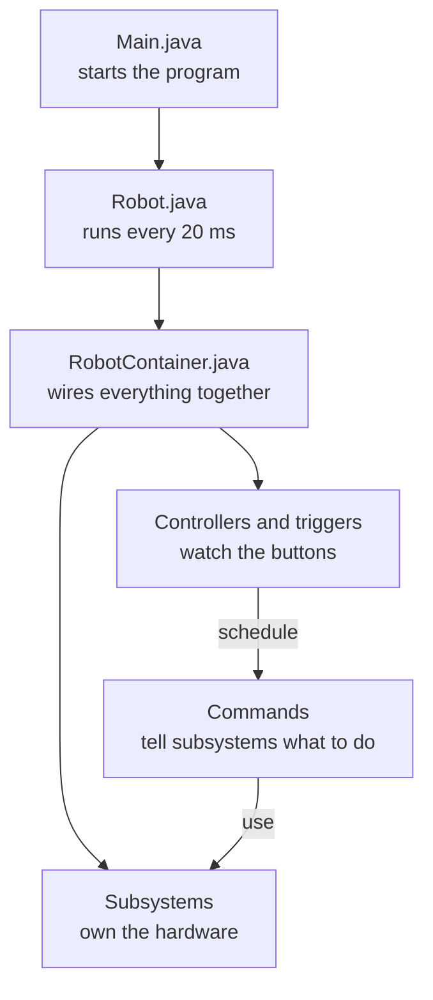

# FRC Nuances

You now know enough Java to read most robot code. This page covers what is __different__ about programming a robot, and the handful of Java features that show up in every FRC project but that a normal Java course barely touches.

Everything with a code editor on this page runs right in your browser. It isn't the real WPILib, but it is a pretend version with the same class names and the same shape, so what you write here is what you'd write on the robot.

!!! note "About the simulator"
    The in-browser robot understands a small slice of WPILib: subsystems, commands, triggers, the scheduler, Xbox controllers, a motor controller, and `DifferentialDrive`. You don't need `import` lines in the editors on this site. Real projects do, and the sections below show them.

## Your code doesn't run top to bottom

In the Java lessons, your program ran from the first line to the last and then stopped. A robot program is different. It starts, and then WPILib calls your code over and over, __50 times every second__ (once every 20 milliseconds), until the robot is switched off. You don't write that loop. You write the pieces WPILib calls, and WPILib decides when.

Which pieces get called depends on what mode the robot is in, which the Driver Station controls:

| Mode | Runs once when it starts | Runs every 20 ms |
|---|---|---|
| Any | `robotInit()` (at startup) | `robotPeriodic()` |
| Disabled | `disabledInit()` | `disabledPeriodic()` |
| Autonomous | `autonomousInit()` | `autonomousPeriodic()` |
| Teleop | `teleopInit()` | `teleopPeriodic()` |

Once the robot is on, press the buttons to switch modes and watch the counter. The dashboard on the right is `SmartDashboard`, which is how robot code shows numbers to the drivers.

```playground
//@ title: The 20 ms loop
//@ panel: robot
//@ show: dashboard
//@ goal: Press Run, then switch the robot between disabled, auto and teleop. Only teleop makes this counter move. Try changing teleopPeriodic to autonomousPeriodic.
//@ lines: 14
public class Robot extends TimedRobot {
    private int m_ticks = 0;

    @Override
    public void teleopPeriodic() {
        m_ticks++;
        SmartDashboard.putNumber("Loop count", m_ticks);
        SmartDashboard.putNumber("Seconds", m_ticks / 50.0);
    }
}
```

Now see if you can predict the order WPILib calls things in. Read it carefully, because `robotPeriodic()` is easy to get wrong.

```playground
//@ title: What order do things run in?
//@ mode: predict
//@ prelude: wpilib
//@ goal: This starts the robot, switches to teleop, and runs 2 loops. Type the 6 lines it prints.
//@ lines: 18
public class Robot extends TimedRobot {
    @Override public void robotInit()      { System.out.println("robotInit"); }
    @Override public void teleopInit()     { System.out.println("teleopInit"); }
    @Override public void teleopPeriodic() { System.out.println("teleopPeriodic"); }
    @Override public void robotPeriodic()  { System.out.println("robotPeriodic"); }
}

Sim.start(new Robot());
Sim.setMode("teleop");
Sim.loops(2);
//@@ explain
The `Init` methods run once. After that, each loop calls the mode's periodic method first and `robotPeriodic()` second. Two loops means two of each pair.
```

!!! tip "Why 20 ms matters"
    Your periodic code has to finish well inside 20 ms. Don't put loops that wait, sleep, or take a long time in there. If your code is slow, the whole robot gets sluggish. This is also why we avoid `Thread.sleep` in robot code.

## The files in a robot project

When WPILib creates a command-based project for you, your code lives in `src/main/java/frc/robot`. Here is what's in it.

```text title="Project layout"
src/main/java/frc/robot/
├── Main.java            Starts the program. Never edit this.
├── Robot.java           The modes: init and periodic methods.
├── RobotContainer.java  Creates subsystems and controllers, connects buttons to commands.
├── Constants.java       Numbers that belong in one place: CAN IDs, ports, speeds.
├── subsystems/          One folder per mechanism on the robot.
|   └── drive/
│       └── Drive.java
│   └── intake/
|       └── pivot
|           └── PivotIO.java
|           └── PivotIOKraken.java
|           └── PivotIOReplay.java
|           └── PivotIOSim.java
|       └── rollers
|           └── RollersIO.java
|           └── RollersIOKraken.java
|           └── RollersIOReplay.java
|           └── RollersIOSim.java
|       └── Intake.java
└── commands/            Larger commands that don't fit inside a subsystem.
```



You will spend most of your time in two places:

- __Subsystems__ hold the hardware and the simple things it can do. See [Subsystems](subsystems.md).
- __RobotContainer__ decides which button does what. See [RobotContainer](robotContainer.md).

`Robot.java` mostly stays as WPILib generated it. The one line that matters is in `robotPeriodic()`:

```java title="Robot.java"
@Override
public void robotPeriodic() {
    CommandScheduler.getInstance().run();
}
```

The __command scheduler__ is the engine of command-based programming. Every 20 ms this one line asks it to check the buttons, run whatever commands are active, and call every subsystem's `periodic()` method. If you delete it, the robot does nothing.

```quiz
@ title: Which file?
? You want to change which CAN ID the intake motor uses. Where is the best place?
- `Main.java`
- `Robot.java`
+ `Constants.java`
- `RobotContainer.java`
> Numbers like CAN IDs live in `Constants.java` so you can find and change them in one place.

? You want the A button to start the intake. Where does that binding go?
- `Main.java`
- `IntakeSubsystem.java`
+ `RobotContainer.java`
- `Constants.java`
> `RobotContainer` connects controller buttons to commands.

? Which file should you never edit?
+ `Main.java`
- `Robot.java`
- `Constants.java`
- `RobotContainer.java`
> WPILib handles `Main.java`. It just starts your robot.

? Which line in `robotPeriodic()` keeps the whole command-based system running?
- `SmartDashboard.updateValues();`
+ `CommandScheduler.getInstance().run();`
- `RobotContainer.run();`
- `super.periodic();`
> The scheduler polls buttons, runs commands and calls subsystem `periodic()` methods.
```

## Java you will see in every robot project

These are the Java features that robot code leans on. Most of them you have partly seen already.

### `package` and `import`

Every file in a real project begins with a `package` line, which says which folder it lives in, and `import` lines, which tell Java where to find the classes you use. WPILib and vendor libraries each have their own.

```java title="IntakeSubsystem.java"
package frc.robot.subsystems;

import com.revrobotics.spark.SparkLowLevel.MotorType;
import com.revrobotics.spark.SparkMax;
import edu.wpi.first.wpilibj2.command.SubsystemBase;
```

You almost never type these by hand. VS Code underlines a class it can't find in red. Click it and choose the quick fix __Import__, or press `Ctrl` + `.` (`Cmd` + `.` on a Mac) while your cursor is on it. The editors on this site skip imports so you can focus on the code.

### `extends`: inheriting from a class

When a class `extends` another, it automatically gets everything the other class has. Almost everything in command-based programming is built this way. Your subsystem `extends SubsystemBase`, so it inherits what makes it a subsystem.

Here is the powerful part. `SubsystemBase` registers every subsystem with the scheduler when it's created, and the scheduler calls each one's `periodic()` method every loop. You never call `periodic()` yourself. Run it and watch.

```playground
//@ title: periodic() is called for you
//@ prelude: wpilib
//@ goal: Run it. Notice that nothing in the code calls periodic(). Then add a second subsystem called Intake that prints its own message.
//@ lines: 14
public class Arm extends SubsystemBase {
    @Override
    public void periodic() {
        System.out.println("Arm periodic");
    }
}

Arm arm = new Arm();

// This is what Robot.java does for you every 20 ms:
CommandScheduler.getInstance().run();
CommandScheduler.getInstance().run();
CommandScheduler.getInstance().run();
```

Now try it yourself. This class has the right method but forgot to extend anything, so the scheduler has no idea it exists.

```playground
//@ title: Make Arm a subsystem
//@ prelude: wpilib
//@ goal: Make Arm a real subsystem so the scheduler calls its periodic() method.
//@ lines: 10
//@ require: extends\s+SubsystemBase | Make Arm extend SubsystemBase.
//@ require: @Override | Mark periodic() with @Override.
public class Arm {
    public void periodic() {
        System.out.println("Arm is alive");
    }
}
//@@ harness
Arm arm = new Arm();
CommandScheduler.getInstance().run();
CommandScheduler.getInstance().run();
//@@ expect
Arm is alive
Arm is alive
//@@ hint
Add `extends SubsystemBase` after the class name.
//@@ hint
Put `@Override` on its own line above `public void periodic()`. This tells Java that you are replacing a method from the parent class.
//@@ solution
public class Arm extends SubsystemBase {
    @Override
    public void periodic() {
        System.out.println("Arm is alive");
    }
}
//@@ explain
`SubsystemBase` does the registering for you. All you do is override `periodic()` with what you want to happen each loop.
```

### `@Override`

`@Override` is a promise to Java: "this method replaces one from the parent class." If you spell it wrong or give it the wrong inputs, Java stops you, instead of silently never calling it. Without `@Override`, a typo like `periodc()` is just a new method that nobody calls, and you'd spend an hour wondering why nothing happens.

```playground
//@ title: The typo that @Override catches
//@ prelude: wpilib
//@ goal: Press Run and read the error message. Fix the typo, then press Check my code.
//@ lines: 8
public class Arm extends SubsystemBase {
    @Override
    public void periodc() {
        System.out.println("Arm periodic");
    }
}
//@@ harness
Arm arm = new Arm();
CommandScheduler.getInstance().run();
//@@ expect
Arm periodic
//@@ hint
Look closely at the method name. Compare it to `periodic`.
//@@ solution
public class Arm extends SubsystemBase {
    @Override
    public void periodic() {
        System.out.println("Arm periodic");
    }
}
//@@ explain
"Method does not override or implement a method from a supertype" always means one thing: the name or inputs don't match the parent's method. Always add `@Override`, and let Java catch typos for you.
```

### `final`, `static`, and constants

You'll see these everywhere, usually together.

- `final` means the variable can never be reassigned after it's set. A motor controller is created once and never swapped out, so we write `private final SparkMax m_motor`.
- `static` means the thing belongs to the class itself, not to each object. So no matter how many objects of a class you make, changing a static variable for one of them changes it for all the objects at the same time.
- A `static final` value is a __constant__: one fixed number that lives in one place.

WPILib teams, including ours, follow two naming habits, and you'll see them in every project:

| Convention | Used for | Example |
|---|---|---|
| `m_` prefix | Member fields of an object | `m_motor`, `m_driverController` |
| `k` prefix | Constants | `kMotorId`, `kIntakeSpeed` |

Robot constants live in `Constants.java`, grouped into small nested classes so related numbers stay together.

```playground
//@ title: A Constants file
//@ goal: Run it. Then change kIntakeSpeed and add a new constant of your own, like kOuttakeSpeed, and print it.
//@ lines: 18
public class Constants {
    public static class IntakeConstants {
        public static final int kMotorId = 5;
        public static final double kIntakeSpeed = 0.8;
    }

    public static class DriveConstants {
        public static final int kLeftMotorId = 1;
        public static final int kRightMotorId = 2;
    }
}

System.out.println("Intake motor on CAN id " + Constants.IntakeConstants.kMotorId);
System.out.println("Intake speed " + Constants.IntakeConstants.kIntakeSpeed);
System.out.println("Left drive motor on CAN id " + Constants.DriveConstants.kLeftMotorId);
```

```playground
//@ title: Add constants
//@ goal: Inside ArmConstants, add two constants: an int called kMotorId set to 9, and a double called kMaxSpeed set to 0.4.
//@ lines: 12
//@ require: static\s+final\s+int\s+kMotorId | Declare kMotorId as public static final int.
//@ require: static\s+final\s+double\s+kMaxSpeed | Declare kMaxSpeed as public static final double.
public class Constants {
    public static class ArmConstants {
        // Add your constants here

    }
}
//@@ harness
System.out.println(Constants.ArmConstants.kMotorId);
System.out.println(Constants.ArmConstants.kMaxSpeed);
//@@ expect
9
0.4
//@@ hint
The pattern is `public static final type kName = value;`
//@@ solution
public class Constants {
    public static class ArmConstants {
        public static final int kMotorId = 9;
        public static final double kMaxSpeed = 0.4;
    }
}
//@@ explain
If the arm motor ever changes CAN id, you fix it in exactly one place, and every file that uses `kMotorId` picks up the change.
```

```quiz
@ title: final and static
? What does `private final SparkMax m_motor;` mean?
- The motor can only be used once
+ The variable `m_motor` can't be pointed at a different motor after it's set
- The motor is faster than a regular one
- The motor is shared by all robots
> `final` locks the variable so it can't be reassigned.

? How would you read a constant `kMaxSpeed` inside `Constants.DriveConstants` from another class?
- `new DriveConstants().kMaxSpeed`
+ `Constants.DriveConstants.kMaxSpeed`
- `kMaxSpeed.DriveConstants.Constants`
- `Constants(DriveConstants).kMaxSpeed`
> Static members belong to the class, so you reach them through the class name with no `new` needed.

? Which name follows WPILib conventions for a field holding a motor?
- `Motor`
+ `m_motor`
- `kMotor`
- `MOTOR_`
> `m_` is for member fields, and `k` is for constants.
```

### Lambdas: code you hand to someone else

A __lambda__ is a method with no name that you can store in a variable and pass around. It's written `() -> something`. The `()` holds any inputs, and the arrow points to the code to run.

This matters in FRC because you often want to say "do this, but not right now, do it when the driver presses a button." Passing `m_motor.set(0.5)` directly would run it immediately, when the code is read. Wrapping it as `() -> m_motor.set(0.5)` gives the scheduler a package to run later.

Lambdas are mainly used in button bindings, where Java expects a `runnable`, and passing it a method with a parameter instead will confuse it.

```playground
//@ title: Running code later
//@ goal: Run it. The counter only changes when run() is called, not when the lambda is created. Add a third call to run().
//@ lines: 12
public class Counter {
    public int value = 0;
}

Counter counter = new Counter();
Runnable addOne = () -> counter.value++;

System.out.println("Before: " + counter.value);
addOne.run();
addOne.run();
System.out.println("After: " + counter.value);
```

A lambda that gives something back is called a __supplier__. `DoubleSupplier` gives back a `double`, and `BooleanSupplier` gives back a `boolean`. Joystick values are a classic use. Pushing the stick changes the value, so you can't just read it once. You pass a supplier that reads it fresh each time.

```playground
//@ title: A snapshot vs a live value
//@ mode: predict
//@ goal: What do the two lines print?
//@ lines: 12
public class Joystick {
    public double y = 0.0;
}

Joystick stick = new Joystick();

double snapshot = stick.y;            // reads the value once, right now
DoubleSupplier live = () -> stick.y;  // reads the value every time it's asked

stick.y = 0.8;

System.out.println("snapshot: " + snapshot);
System.out.println("live: " + live.getAsDouble());
//@@ explain
`snapshot` was copied while the stick was still at 0.0 and never changes. The lambda `live` looks at the stick when asked, so it sees 0.8. This is exactly why drive commands take `() -> controller.getLeftY()` instead of `controller.getLeftY()`.
```

Finally, you'll sometimes see `this::method` or `m_intake::isReady`. That's a __method reference__, shorthand for a lambda that does nothing but call that method: `m_intake::isReady` means the same as `() -> m_intake.isReady()`.

```quiz
@ title: Lambdas
? What does `() -> m_motor.set(0.5)` do when Java reaches it?
- Sets the motor to 0.5 immediately
+ Creates a package of code to be run later, without running it yet
- Throws an error
- Sets the motor to 0.5 for 20 ms
> A lambda is just code waiting to be run. Calling it (or having the scheduler call it) is what runs it.

? Which one passes a __live__ joystick reading to a drive command?
- `controller.getLeftY()`
+ `() -> controller.getLeftY()`
- `getLeftY`
- `controller.getLeftY`
> The lambda is a `DoubleSupplier` that gets asked for the latest value every loop.

? `m_intake::isReady` is shorthand for which lambda?
- `() -> m_intake`
+ `() -> m_intake.isReady()`
- `m_intake -> isReady`
- `() -> isReady`
> A method reference is a shortcut for a lambda that only calls that method.
```

---

## What's next

You now know how a robot program runs, where things live, and the Java that holds it together. Next you will build the pieces:

- [Subsystems](subsystems.md): write the class that owns a mechanism.
- [RobotContainer](robotContainer.md): connect controller buttons to what the robot does.
