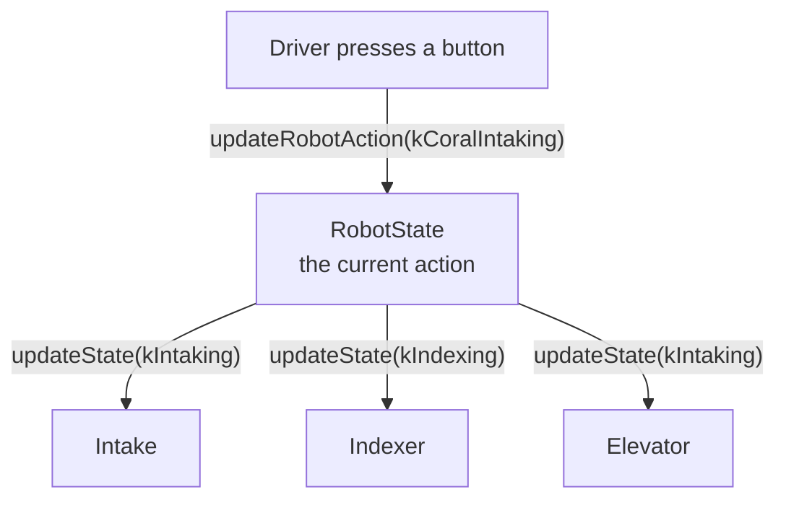

# RobotState

Say the driver presses one button: __intake__. Think about everything that has to happen. The intake rollers spin. The indexer starts moving the game piece along. The elevator drops to the pickup height. Three subsystems, one button.

Where does the code that coordinates them go?

- __In the button binding?__ Then every button needs a long list of subsystem calls, and the same list gets copied anywhere else the robot intakes, like in autonomous.
- __In a subsystem?__ Then the intake has to know about the elevator, and the elevator has to know about the indexer. Our subsystems are built so each one only knows about itself.

Our answer is a class called `RobotState`. It sits above all the subsystems and keeps track of one thing: __what is the robot trying to do right now?__

!!! info "Two levels of state"
    __Subsystem states__ say what one mechanism is doing: the intake is `kIntaking`.
    __Robot actions__ say what the whole robot is doing: the robot is `kCoralIntaking`.
    One action sets a state for every subsystem it needs.



You've already used the idea twice. A subsystem is an enum of states plus a map from each state to the method that runs. `RobotState` does the same thing one level up, with an enum of __actions__.

## RobotAction: what the robot is trying to do

Here are a few of the actions from our 2025 robot.

```java title="RobotState.java"
public enum RobotAction {
    kTeleopDefault,   // nothing special: everything rests
    kCoralIntaking,   // get a game piece into the robot
    kCoralOuttaking,  // release the game piece we're holding
    kAutoScore,       // drive to the reef and score on our own
    kManualScore,     // raise the elevator, driver lines up
    kCoralEject,      // spit the game piece back out
    // ...about twenty more
}
```

Each one is a __goal__, not a motor setting. `kCoralIntaking` doesn't say how fast anything spins. It says what we're trying to do, and each subsystem knows how to do its part.

## One instance for the whole robot

Any button, anywhere, needs to be able to say "change the robot's action." So there is exactly one `RobotState`, and any file can get it by calling `RobotState.getInstance()`. A class that only ever has one object is called a __singleton__, and it's built from things you already know: `static` and `private`.

```java title="RobotState.java"
public class RobotState {
    private static RobotState m_instance;

    private RobotState(Drive drive, Intake intake, Indexer indexer, /* ... */) {
        // ...save the subsystems, build the map of actions...
    }

    public static RobotState startInstance(Drive drive, Intake intake, Indexer indexer, /* ... */) {
        if (m_instance == null) {
            m_instance = new RobotState(drive, intake, indexer, /* ... */);
        }
        return m_instance;
    }

    public static RobotState getInstance() {
        return m_instance;
    }
}
```

- The constructor is `private`, so nobody else can write `new RobotState(...)`.
- `m_instance` is `static`, so it belongs to the class itself and is shared by everyone.
- `startInstance` builds it once, at startup. It needs the subsystems, so it can only run __after__ `RobotContainer` has created them. That's why `configureCommands()` in our `RobotContainer` calls it, with a comment saying "we start here so autofactory won't be null".
- After that, everyone calls `getInstance()`.

Predict what this prints. Pay attention to what `a == b` asks Java: not "do they look the same?" but "are they the very same object?"

```playground
//@ title: One object, shared
//@ mode: predict
//@ goal: Both calls to getInstance() happen in different places. Type the two lines this prints.
//@ lines: 18
public class Config {
    private static Config m_instance;
    private int m_value = 0;

    private Config() {}

    public static Config getInstance() {
        if (m_instance == null) {
            m_instance = new Config();
        }
        return m_instance;
    }

    public void add(int amount) { m_value += amount; }
    public int get() { return m_value; }
}

Config.getInstance().add(5);
Config.getInstance().add(2);

Config a = Config.getInstance();
Config b = Config.getInstance();
System.out.println(a.get());
System.out.println(a == b);
//@@ expect
7
true
//@@ explain
There's only one `Config`. Both `add` calls changed the same object, so its value is 7, and `a` and `b` are two names for that one object. This is how a button binding and an autonomous routine can both talk to the same `RobotState`.
```

## Changing the action

Every button that changes what the robot is doing ends up calling one method: `updateRobotAction`. It follows the same three steps every time.

```java title="updateRobotAction(), shortened"
public void updateRobotAction(RobotAction newAction) {
    // 1. Start every subsystem at its resting state
    IntakeState newIntakeState = IntakeState.kStow;
    IndexerState newIndexerState = IndexerState.kIdle;
    ElevatorState newElevatorState = ElevatorState.kStow;

    // 2. Let the action change the ones it cares about
    switch (newAction) {
        case kCoralIntaking:
            newIntakeState = IntakeState.kFunnelIntaking;
            newElevatorState = ElevatorState.kIntaking;
            break;

        case kManualScore:
            newElevatorState = ElevatorState.kScoring;
            break;

        case kTeleopDefault:
            break;
    }

    // 3. Remember the action, then tell each subsystem, but only if its state is changing
    m_profiles.setCurrentProfile(newAction);

    if (m_intake.getCurrentState() != newIntakeState) {
        m_intake.updateState(newIntakeState);
    }
    if (m_indexer.getCurrentState() != newIndexerState) {
        m_indexer.updateState(newIndexerState);
    }
    if (m_elevator.getCurrentState() != newElevatorState) {
        m_elevator.updateState(newElevatorState);
    }
}
```

Step 1 is the clever one. Because everything starts at "rest," an action only has to list what is __different__. Switching from intaking to the default action puts everything back without a single line of cleanup. Nothing gets left running by accident.

Step 3 only updates a subsystem when its state is actually changing, so we don't restart a motion that's already going.

A small honesty note: for some subsystems, "rest" depends on what's happening. Our real code doesn't start the intake at `kStow` but at `m_intake.getStowOrHold()`, which stays in the hold state if the intake is already holding a game piece, and only stows otherwise. The idea is the same: start from a default, then let the action change it.

!!! note "A `switch` needs a `break`"
    Each `case` ends with `break`. Without it, Java keeps running into the next case. Our code has a comment on this: "guys don't use fallthrough it's not worth it". Two cases that do the same thing can share a body by being stacked (`case kAutoScore:` directly above `case kAutoAutoScore:`), but any case with code in it ends in `break`.

Here is the whole thing running. The button bindings are one-liners, just like the real `RobotContainer`. Run it, switch to __Teleop__, and press __A__ (intake), __B__ (score), and __X__ (back to default). Watch three subsystems change together on the dashboard. The DIO 0 button is a pretend sensor that says "we have a game piece."

```playground
//@ title: One button, three subsystems
//@ panel: robot
//@ show: controller,motors,dashboard
//@ dio: 0
//@ goal: Run it, go to Teleop, and press A. The intake and indexer start together. Then press DIO 0 (we have a piece): the indexer stops by itself. Press B to score, then X for default.
//@ lines: 120
//@ maxlines: 36
public class Intake extends SubsystemBase {
    public static enum IntakeState { kStow, kIntaking }

    private final TalonFX m_motor = new TalonFX(1);
    private IntakeState m_state = IntakeState.kStow;

    public void updateState(IntakeState state) { m_state = state; }
    public IntakeState getCurrentState() { return m_state; }

    @Override
    public void periodic() {
        m_motor.set(m_state == IntakeState.kIntaking ? 0.7 : 0.0);
        Logger.recordOutput("Intake/State", m_state);
    }
}

public class Indexer extends SubsystemBase {
    public static enum IndexerState { kIdle, kIndexing }

    private final TalonFX m_motor = new TalonFX(2);
    private final DigitalInput m_sensor = new DigitalInput(0);
    private IndexerState m_state = IndexerState.kIdle;

    public void updateState(IndexerState state) { m_state = state; }
    public IndexerState getCurrentState() { return m_state; }
    public boolean hasGamePiece() { return m_sensor.get(); }

    @Override
    public void periodic() {
        m_motor.set(m_state == IndexerState.kIndexing ? 0.5 : 0.0);
        Logger.recordOutput("Indexer/State", m_state);
    }
}

public class Elevator extends SubsystemBase {
    public static enum ElevatorState { kStow, kIntaking, kScoring }

    private ElevatorState m_state = ElevatorState.kStow;

    public void updateState(ElevatorState state) { m_state = state; }
    public ElevatorState getCurrentState() { return m_state; }

    @Override
    public void periodic() {
        Logger.recordOutput("Elevator/State", m_state);
    }
}

public class RobotState {
    public enum RobotAction { kTeleopDefault, kCoralIntaking, kManualScore }

    private static RobotState m_instance;

    private final Intake m_intake;
    private final Indexer m_indexer;
    private final Elevator m_elevator;
    private final SubsystemProfiles<RobotAction> m_profiles;

    private RobotState(Intake intake, Indexer indexer, Elevator elevator) {
        m_intake = intake;
        m_indexer = indexer;
        m_elevator = elevator;

        Map<RobotAction, Runnable> periodicHash = new HashMap<>();
        periodicHash.put(RobotAction.kTeleopDefault, () -> {});
        periodicHash.put(RobotAction.kCoralIntaking, this::coralIntakingPeriodic);
        periodicHash.put(RobotAction.kManualScore, () -> {});

        m_profiles = new SubsystemProfiles<>(periodicHash, RobotAction.kTeleopDefault);
    }

    public static RobotState startInstance(Intake intake, Indexer indexer, Elevator elevator) {
        if (m_instance == null) {
            m_instance = new RobotState(intake, indexer, elevator);
        }
        return m_instance;
    }

    public static RobotState getInstance() {
        return m_instance;
    }

    public void updateRobotState() {
        m_profiles.getPeriodicFunctionTimed().run();
        Logger.recordOutput("RobotState/CurrentAction", m_profiles.getCurrentProfile());
    }

    public void updateRobotAction(RobotAction newAction) {
        IntakeState newIntakeState = IntakeState.kStow;
        IndexerState newIndexerState = IndexerState.kIdle;
        ElevatorState newElevatorState = ElevatorState.kStow;

        switch (newAction) {
            case kCoralIntaking:
                newIntakeState = IntakeState.kIntaking;
                newIndexerState = IndexerState.kIndexing;
                newElevatorState = ElevatorState.kIntaking;
                break;

            case kManualScore:
                newElevatorState = ElevatorState.kScoring;
                break;

            case kTeleopDefault:
                break;
        }

        m_profiles.setCurrentProfile(newAction);

        if (m_intake.getCurrentState() != newIntakeState) { m_intake.updateState(newIntakeState); }
        if (m_indexer.getCurrentState() != newIndexerState) { m_indexer.updateState(newIndexerState); }
        if (m_elevator.getCurrentState() != newElevatorState) { m_elevator.updateState(newElevatorState); }
    }

    public void setDefaultAction() {
        updateRobotAction(RobotAction.kTeleopDefault);
    }

    // runs every loop while we are intaking
    public void coralIntakingPeriodic() {
        if (m_indexer.hasGamePiece()) {
            m_indexer.updateState(IndexerState.kIdle);
        } else {
            m_indexer.updateState(IndexerState.kIndexing);
        }
    }
}

public class RobotContainer {
    private final Intake m_intake = new Intake();
    private final Indexer m_indexer = new Indexer();
    private final Elevator m_elevator = new Elevator();
    private final CommandXboxController m_driver = new CommandXboxController(0);

    public RobotContainer() {
        RobotState.startInstance(m_intake, m_indexer, m_elevator);

        m_driver.a().onTrue(Commands.runOnce(
            () -> RobotState.getInstance().updateRobotAction(RobotState.RobotAction.kCoralIntaking)));
        m_driver.b().onTrue(Commands.runOnce(
            () -> RobotState.getInstance().updateRobotAction(RobotState.RobotAction.kManualScore)));
        m_driver.x().onTrue(Commands.runOnce(
            () -> RobotState.getInstance().setDefaultAction()));
    }
}

public class Robot extends LoggedRobot {
    private RobotContainer m_robotContainer;

    @Override
    public void robotInit() {
        m_robotContainer = new RobotContainer();
    }

    @Override
    public void robotPeriodic() {
        RobotState.getInstance().updateRobotState();
        CommandScheduler.getInstance().run();
    }
}
```

Look at `Robot.robotPeriodic()` at the bottom. It's the real thing: `RobotState` goes first, then the scheduler, which polls the buttons and calls each subsystem's `periodic()`. Each subsystem here is shortened to its state and one motor. You built the full layered versions on the [Subsystems](subsystems.md) page.

## Actions that run code every loop

An action isn't only a set of starting states. Each one can have a method that runs __every loop__ while it's the current action, using the same map-of-methods trick as the subsystems. That's how `kCoralIntaking` above reacted to the sensor: the indexer stops when the game piece arrives, and starts again if it leaves.

An action can also end itself. Here's how our robot finishes scoring:

```java title="coralOuttakingPeriodic(), shortened"
public void coralOuttakingPeriodic() {
    // after the game piece has been out for a moment, we're done: go back to rest
    if (m_timer.hasElapsed(ManipulatorConstants.kCoralOuttakeTimeout.get())) {
        setDefaultAction();
    }
    // keep resetting the timer while we still have the game piece
    if (m_manipulator.hasGamePiece() || !m_timer.isRunning()) {
        m_timer.restart();
    }
}
```

`m_timer` is a WPILib `Timer`. The robot is holding the button's goal ("score") until the sensors say it worked. The driver doesn't have to press anything to stop it.

One more detail from the real `updateRobotAction`: every time the action changes, it also resets the timers and flags. That way a timer left running from the last action can't make the new one end early.

### Your turn: add an action

The robot needs a new action, `kCoralEject`, which spits a game piece back out. The intake should run outward and the indexer should eject. The new action needs to be added in three places, like the subsystem states: the enum, the map, and the `switch`.

```playground
//@ title: Add the eject action
//@ prelude: wpilib
//@ goal: Add a kCoralEject action. It should set the intake to kOuttaking and the indexer to kEject. Add it to the enum, register it in periodicHash (with an empty method), and handle it in the switch.
//@ lines: 64
//@ maxlines: 30
//@ require: case\s+kCoralEject\s*: | Add a case for kCoralEject in the switch.
//@ require: periodicHash\.put\(\s*RobotAction\.kCoralEject | Register kCoralEject in periodicHash.
public class Intake {
    public static enum IntakeState { kStow, kIntaking, kOuttaking }
    private IntakeState m_state = IntakeState.kStow;
    public void updateState(IntakeState state) { m_state = state; }
    public IntakeState getCurrentState() { return m_state; }
}

public class Indexer {
    public static enum IndexerState { kIdle, kIndexing, kEject }
    private IndexerState m_state = IndexerState.kIdle;
    public void updateState(IndexerState state) { m_state = state; }
    public IndexerState getCurrentState() { return m_state; }
}

public class RobotState {
    public enum RobotAction { kTeleopDefault, kCoralIntaking }

    private static RobotState m_instance;
    private final Intake m_intake;
    private final Indexer m_indexer;
    private final SubsystemProfiles<RobotAction> m_profiles;

    private RobotState(Intake intake, Indexer indexer) {
        m_intake = intake;
        m_indexer = indexer;

        Map<RobotAction, Runnable> periodicHash = new HashMap<>();
        periodicHash.put(RobotAction.kTeleopDefault, () -> {});
        periodicHash.put(RobotAction.kCoralIntaking, () -> {});

        m_profiles = new SubsystemProfiles<>(periodicHash, RobotAction.kTeleopDefault);
    }

    public static RobotState startInstance(Intake intake, Indexer indexer) {
        if (m_instance == null) { m_instance = new RobotState(intake, indexer); }
        return m_instance;
    }

    public static RobotState getInstance() { return m_instance; }

    public RobotAction getCurrentAction() { return m_profiles.getCurrentProfile(); }

    public void updateRobotState() { m_profiles.getPeriodicFunctionTimed().run(); }

    public void updateRobotAction(RobotAction newAction) {
        IntakeState newIntakeState = IntakeState.kStow;
        IndexerState newIndexerState = IndexerState.kIdle;

        switch (newAction) {
            case kCoralIntaking:
                newIntakeState = IntakeState.kIntaking;
                newIndexerState = IndexerState.kIndexing;
                break;

            case kTeleopDefault:
                break;
        }

        m_profiles.setCurrentProfile(newAction);

        if (m_intake.getCurrentState() != newIntakeState) { m_intake.updateState(newIntakeState); }
        if (m_indexer.getCurrentState() != newIndexerState) { m_indexer.updateState(newIndexerState); }
    }
}
//@@ harness
Intake intake = new Intake();
Indexer indexer = new Indexer();
RobotState.startInstance(intake, indexer);
RobotState.getInstance().updateRobotAction(RobotState.RobotAction.kCoralEject);
RobotState.getInstance().updateRobotState();
System.out.println(RobotState.getInstance().getCurrentAction());
System.out.println(intake.getCurrentState());
System.out.println(indexer.getCurrentState());
//@@ expect
kCoralEject
kOuttaking
kEject
//@@ hint
Three edits: add `kCoralEject` to the `RobotAction` enum, add a `periodicHash.put(RobotAction.kCoralEject, () -> {});` line, and add a new `case` to the `switch`.
//@@ hint
The new case looks like the intaking one: set `newIntakeState` and `newIndexerState`, then `break;`.
//@@ solution
public class Intake {
    public static enum IntakeState { kStow, kIntaking, kOuttaking }
    private IntakeState m_state = IntakeState.kStow;
    public void updateState(IntakeState state) { m_state = state; }
    public IntakeState getCurrentState() { return m_state; }
}

public class Indexer {
    public static enum IndexerState { kIdle, kIndexing, kEject }
    private IndexerState m_state = IndexerState.kIdle;
    public void updateState(IndexerState state) { m_state = state; }
    public IndexerState getCurrentState() { return m_state; }
}

public class RobotState {
    public enum RobotAction { kTeleopDefault, kCoralIntaking, kCoralEject }

    private static RobotState m_instance;
    private final Intake m_intake;
    private final Indexer m_indexer;
    private final SubsystemProfiles<RobotAction> m_profiles;

    private RobotState(Intake intake, Indexer indexer) {
        m_intake = intake;
        m_indexer = indexer;

        Map<RobotAction, Runnable> periodicHash = new HashMap<>();
        periodicHash.put(RobotAction.kTeleopDefault, () -> {});
        periodicHash.put(RobotAction.kCoralIntaking, () -> {});
        periodicHash.put(RobotAction.kCoralEject, () -> {});

        m_profiles = new SubsystemProfiles<>(periodicHash, RobotAction.kTeleopDefault);
    }

    public static RobotState startInstance(Intake intake, Indexer indexer) {
        if (m_instance == null) { m_instance = new RobotState(intake, indexer); }
        return m_instance;
    }

    public static RobotState getInstance() { return m_instance; }

    public RobotAction getCurrentAction() { return m_profiles.getCurrentProfile(); }

    public void updateRobotState() { m_profiles.getPeriodicFunctionTimed().run(); }

    public void updateRobotAction(RobotAction newAction) {
        IntakeState newIntakeState = IntakeState.kStow;
        IndexerState newIndexerState = IndexerState.kIdle;

        switch (newAction) {
            case kCoralIntaking:
                newIntakeState = IntakeState.kIntaking;
                newIndexerState = IndexerState.kIndexing;
                break;

            case kCoralEject:
                newIntakeState = IntakeState.kOuttaking;
                newIndexerState = IndexerState.kEject;
                break;

            case kTeleopDefault:
                break;
        }

        m_profiles.setCurrentProfile(newAction);

        if (m_intake.getCurrentState() != newIntakeState) { m_intake.updateState(newIntakeState); }
        if (m_indexer.getCurrentState() != newIndexerState) { m_indexer.updateState(newIndexerState); }
    }
}
//@@ explain
Adding an action is the same recipe as adding a subsystem state: the enum, the map, and the code that says what it does. Because step 1 starts every subsystem at rest, you only had to list the two things this action changes.
```

### Your turn: make an action end itself

Now the other direction. `kCoralOuttaking` should finish on its own: after 3 loops it should call `setDefaultAction()` to put the robot back at rest. (The real robot uses a `Timer`. This version counts loops, since each loop is 20 ms.)

```playground
//@ title: End the action by itself
//@ prelude: wpilib
//@ goal: Write coralOuttakingPeriodic. Once m_loopCount reaches kOuttakeLoops, call setDefaultAction() so the robot goes back to rest.
//@ lines: 52
//@ maxlines: 30
//@ require: setDefaultAction\(\) | Call setDefaultAction() when the time is up.
public class Intake {
    public static enum IntakeState { kStow, kOuttaking }
    private IntakeState m_state = IntakeState.kStow;
    public void updateState(IntakeState state) { m_state = state; }
    public IntakeState getCurrentState() { return m_state; }
}

public class RobotState {
    public enum RobotAction { kTeleopDefault, kCoralOuttaking }

    private static final int kOuttakeLoops = 3;
    private static RobotState m_instance;
    private final Intake m_intake;
    private final SubsystemProfiles<RobotAction> m_profiles;
    private int m_loopCount = 0;

    private RobotState(Intake intake) {
        m_intake = intake;

        Map<RobotAction, Runnable> periodicHash = new HashMap<>();
        periodicHash.put(RobotAction.kTeleopDefault, () -> {});
        periodicHash.put(RobotAction.kCoralOuttaking, this::coralOuttakingPeriodic);

        m_profiles = new SubsystemProfiles<>(periodicHash, RobotAction.kTeleopDefault);
    }

    public static RobotState startInstance(Intake intake) {
        if (m_instance == null) { m_instance = new RobotState(intake); }
        return m_instance;
    }

    public static RobotState getInstance() { return m_instance; }

    public RobotAction getCurrentAction() { return m_profiles.getCurrentProfile(); }

    public void updateRobotState() {
        m_profiles.getPeriodicFunctionTimed().run();
        m_loopCount++;
    }

    public void updateRobotAction(RobotAction newAction) {
        IntakeState newIntakeState = IntakeState.kStow;

        switch (newAction) {
            case kCoralOuttaking:
                newIntakeState = IntakeState.kOuttaking;
                break;

            case kTeleopDefault:
                break;
        }

        m_profiles.setCurrentProfile(newAction);
        m_intake.updateState(newIntakeState);

        // a new action starts its count from zero
        m_loopCount = 0;
    }

    public void setDefaultAction() {
        updateRobotAction(RobotAction.kTeleopDefault);
    }

    public void coralOuttakingPeriodic() {
        // After kOuttakeLoops loops, go back to the default action:
    }
}
//@@ harness
Intake intake = new Intake();
RobotState.startInstance(intake);
RobotState.getInstance().updateRobotAction(RobotState.RobotAction.kCoralOuttaking);
for (int i = 0; i < 5; i++) {
    RobotState.getInstance().updateRobotState();
    System.out.println(RobotState.getInstance().getCurrentAction() + " " + intake.getCurrentState());
}
//@@ expect
kCoralOuttaking kOuttaking
kCoralOuttaking kOuttaking
kCoralOuttaking kOuttaking
kTeleopDefault kStow
kTeleopDefault kStow
//@@ hint
Use an `if` that compares `m_loopCount` with `kOuttakeLoops`.
//@@ hint
`if (m_loopCount >= kOuttakeLoops) { setDefaultAction(); }`
//@@ solution
public class Intake {
    public static enum IntakeState { kStow, kOuttaking }
    private IntakeState m_state = IntakeState.kStow;
    public void updateState(IntakeState state) { m_state = state; }
    public IntakeState getCurrentState() { return m_state; }
}

public class RobotState {
    public enum RobotAction { kTeleopDefault, kCoralOuttaking }

    private static final int kOuttakeLoops = 3;
    private static RobotState m_instance;
    private final Intake m_intake;
    private final SubsystemProfiles<RobotAction> m_profiles;
    private int m_loopCount = 0;

    private RobotState(Intake intake) {
        m_intake = intake;

        Map<RobotAction, Runnable> periodicHash = new HashMap<>();
        periodicHash.put(RobotAction.kTeleopDefault, () -> {});
        periodicHash.put(RobotAction.kCoralOuttaking, this::coralOuttakingPeriodic);

        m_profiles = new SubsystemProfiles<>(periodicHash, RobotAction.kTeleopDefault);
    }

    public static RobotState startInstance(Intake intake) {
        if (m_instance == null) { m_instance = new RobotState(intake); }
        return m_instance;
    }

    public static RobotState getInstance() { return m_instance; }

    public RobotAction getCurrentAction() { return m_profiles.getCurrentProfile(); }

    public void updateRobotState() {
        m_profiles.getPeriodicFunctionTimed().run();
        m_loopCount++;
    }

    public void updateRobotAction(RobotAction newAction) {
        IntakeState newIntakeState = IntakeState.kStow;

        switch (newAction) {
            case kCoralOuttaking:
                newIntakeState = IntakeState.kOuttaking;
                break;

            case kTeleopDefault:
                break;
        }

        m_profiles.setCurrentProfile(newAction);
        m_intake.updateState(newIntakeState);

        // a new action starts its count from zero
        m_loopCount = 0;
    }

    public void setDefaultAction() {
        updateRobotAction(RobotAction.kTeleopDefault);
    }

    public void coralOuttakingPeriodic() {
        if (m_loopCount >= kOuttakeLoops) {
            setDefaultAction();
        }
    }
}
//@@ explain
Nobody pressed anything to stop it. After three loops the action ended itself, and because `updateRobotAction` starts every subsystem at rest, the intake went back to `kStow` with no extra code. Notice the count is reset inside `updateRobotAction`, just like the real code resets its timers on every new action.
```

## Who is allowed to change what?

With three layers, it helps to have a rule for who talks to whom.

- __Buttons__ (in `RobotContainer`) ask `RobotState` for an action. They almost never talk to a subsystem directly.
- __`RobotState`__ turns an action into a state for each subsystem.
- __Subsystems__ run their own state and talk to their own IO. They don't change each other's states.

Our code isn't perfectly strict about it, and that's fine. A subsystem can __read__ `RobotState` when it needs to know something about the whole robot (our indexer checks whether the manipulator is auto-reversing). A few simple buttons skip it altogether: the climb button flips the climb between two states, and a comment in the code says "this isn't gonna be in robot state because that's too much work."

The rule of thumb: if a button needs __more than one subsystem__, or needs the robot to remember __what it's doing__, it goes through `RobotState`. If it's one mechanism flipping between two states, it can call the subsystem directly.

```quiz
@ title: RobotState
? Why does `RobotState` exist, instead of each button changing every subsystem it needs?
- Java requires it
+ One place decides what all the subsystems should do together, so buttons and autonomous don't duplicate the lists
- It makes the motors faster
- Subsystems can't have states
> One action can set several subsystems at once, and every button (and autonomous) reuses it.

? What makes `RobotState` a singleton?
- It extends `SubsystemBase`
+ A private constructor and a static instance that everyone gets through `getInstance()`
- It's declared `final`
- It has only one method
> Nobody else can call `new RobotState(...)`, so there can only be the one built by `startInstance`.

? Why does `updateRobotAction` start every subsystem at its resting state before the `switch`?
- To make the code longer
+ So an action only lists what it changes, and nothing from the previous action gets left running
- Because `switch` requires it
- To reset the log file
> Switching back to the default action puts everything at rest with no cleanup code.

? A `case` in the `switch` sets some states but has no `break`. What happens?
- Java reports an error
+ Java keeps running into the next case's code too
- The robot stops
- Nothing, `break` is optional
> That's called fallthrough. Our team avoids it for any case that has code in it.

? When does `RobotState` call each subsystem's `updateState`?
+ When the action changes, in `updateRobotAction`
- Every 20 ms
- Only when the robot is disabled
- Never. The subsystems do it themselves.
> `updateRobotAction` sets them in one go. The action's own periodic method may adjust some every loop.

? In `robotPeriodic()`, which comes first?
- `CommandScheduler.getInstance().run()`
+ `RobotState.getInstance().updateRobotState()`
- Neither. They run at the same time.
- The order doesn't exist, only one runs.
> The robot decides what it's doing first, then the scheduler runs the subsystems.
```

---

## What's next

You now have the full picture of how a button press becomes motor output: a binding asks `RobotState` for an action, `RobotState` sets each subsystem's state, and each subsystem's `periodic()` runs its state through an IO class. The last piece is where all the numbers in those states live. That's [Constants](constants.md).
