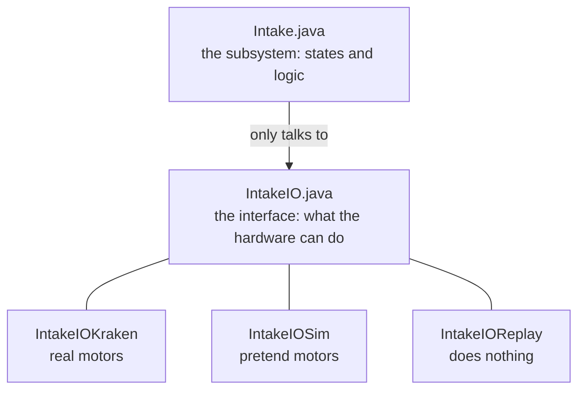
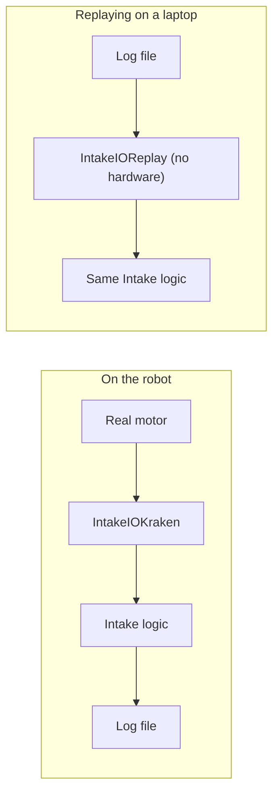

# Subsystems

A __subsystem__ is one mechanism on the robot: the intake, the elevator, the climber. On our team, every subsystem is built the same way, in three layers, and it runs on __states__. Once you've seen one, you can read all of them.

This page builds an intake from scratch. Every editor runs in your browser, so you can try each idea as you read.

## Three layers

The rule is the one from the Java lessons: __only one class touches the hardware.__ Everything else asks. We take that rule one step further and split each mechanism into three layers.



- __`IntakeIO`__ is an interface. It lists everything the hardware can do (spin at some voltage) and everything it can report (how fast it's spinning).
- __`IntakeIOKraken`, `IntakeIOSim` and `IntakeIOReplay`__ each implement that interface. One talks to real motors, one is a pretend intake, and one does nothing.
- __`Intake`__ is the subsystem. It holds an `IntakeIO` and never knows which one. All the thinking happens here.

!!! note "Our real intake is two mechanisms"
    To keep this page small, we're building an intake with a single roller. On the real robot, the intake is a roller __and__ a pivot arm, so it has two IO folders, `intake/roller/` (`IntakeRollerIO`) and `intake/pivot/` (`PivotIO`), each with its own Kraken, Sim and Replay classes. One `Intake` subsystem holds both. When you open the real code, that's why you won't find a file called `IntakeIO`. Every piece works exactly the way it does here, just twice. The `Manipulator` does the same thing with a roller, a wrist and a sensor.

Why go to all this trouble? Three reasons.

1. __We can test without a robot.__ The robot isn't always available, and half the team wants to code at the same time. With `IntakeIOSim`, your code runs on a laptop.
2. __We can replay matches.__ Every loop, the robot logs everything the hardware reported. After a match, we feed that log back through the same `Intake` code on a laptop, using the replay class so no hardware is needed, and watch exactly what the code decided. If something went wrong, we can find out why.
3. __Changing hardware touches one file.__ Swap a motor type and only the Kraken class changes. The logic doesn't care.



## Try the finished intake

Here is the whole thing working. Read it once, press __Run__, switch to __Teleop__, then press __A__ (intake), __B__ (outtake) and __X__ (stow). Watch the dashboard on the right. You'll see the state change and the speed ramp up. You will build each of these pieces yourself below.

```playground
//@ title: The finished intake
//@ panel: robot
//@ show: controller,dashboard
//@ goal: Run it, switch to Teleop, and press A, B and X. Notice that the speed doesn't jump instantly, because the pretend motor takes a moment to spin up.
//@ lines: 70
//@ maxlines: 34
public interface IntakeIO {
    @AutoLog
    public static class IntakeInputs {
        public double velocityRPS;
        public double voltage;
    }

    public void updateInputs(IntakeInputs inputs);

    public void setVoltage(double voltage);
}

public class IntakeIOSim implements IntakeIO {
    private double m_voltage = 0.0;
    private double m_velocity = 0.0;

    @Override
    public void updateInputs(IntakeInputs inputs) {
        // spin up a little each loop, like a real motor does
        m_velocity += (m_voltage * 8.0 - m_velocity) * 0.2;
        inputs.velocityRPS = m_velocity;
        inputs.voltage = m_voltage;
    }

    @Override
    public void setVoltage(double voltage) {
        m_voltage = voltage;
    }
}

public class Intake extends SubsystemBase {
    public static enum IntakeState {
        kStow,
        kIntaking,
        kOuttaking
    }

    private final IntakeIO m_io;
    private final IntakeInputsAutoLogged m_inputs = new IntakeInputsAutoLogged();
    private final SubsystemProfiles<IntakeState> m_profiles;

    public Intake(IntakeIO io) {
        m_io = io;

        Map<IntakeState, Runnable> periodicHash = new HashMap<>();
        periodicHash.put(IntakeState.kStow, this::stowPeriodic);
        periodicHash.put(IntakeState.kIntaking, this::intakingPeriodic);
        periodicHash.put(IntakeState.kOuttaking, this::outtakingPeriodic);

        m_profiles = new SubsystemProfiles<>(periodicHash, IntakeState.kStow);
    }

    public void updateState(IntakeState state) {
        m_profiles.setCurrentProfile(state);
    }

    public IntakeState getCurrentState() {
        return m_profiles.getCurrentProfile();
    }

    @Override
    public void periodic() {
        m_io.updateInputs(m_inputs);

        m_profiles.getPeriodicFunctionTimed().run();

        Logger.processInputs("Intake", m_inputs);
        Logger.recordOutput("Intake/State", m_profiles.getCurrentProfile());
    }

    public void stowPeriodic() {
        m_io.setVoltage(0.0);
    }

    public void intakingPeriodic() {
        m_io.setVoltage(8.0);
    }

    public void outtakingPeriodic() {
        m_io.setVoltage(-8.0);
    }
}

// Buttons just change the state. You'll see how this works in RobotContainer.
public class RobotContainer {
    private final Intake m_intake = new Intake(new IntakeIOSim());
    private final CommandXboxController m_driver = new CommandXboxController(0);

    public RobotContainer() {
        m_driver.a().onTrue(Commands.runOnce(() -> m_intake.updateState(Intake.IntakeState.kIntaking)));
        m_driver.b().onTrue(Commands.runOnce(() -> m_intake.updateState(Intake.IntakeState.kOuttaking)));
        m_driver.x().onTrue(Commands.runOnce(() -> m_intake.updateState(Intake.IntakeState.kStow)));
    }
}
```

Now let's build it, one layer at a time.

## Layer 1: the IO interface

The interface does two jobs. It lists what you can __tell__ the hardware to do (`setVoltage`), and it defines everything the hardware can __report__, bundled into an inputs class.

```java title="IntakeIO.java"
public interface IntakeIO {
    @AutoLog
    public static class IntakeInputs {
        public double velocityRPS;
        public double voltage;
    }

    public void updateInputs(IntakeInputs inputs);

    public void setVoltage(double voltage);
}
```

The inputs class is just a bag of public fields: speed, voltage, current, temperature, and whether the motor is even connected. The `@AutoLog` above it tells AdvantageKit, our logging library, to record every field in it. `updateInputs` fills the bag with fresh readings, and `setVoltage` is a command going the other way.

We control intake motors with __voltage__ instead of a percent. A battery gives about 12 volts, so `8.0` means two thirds power, and unlike a percent, it doesn't change when the battery sags.

Your turn. `IntakeIOSim` is finished below, but the interface it implements doesn't exist yet. Write it.

```playground
//@ title: Write the IO interface
//@ goal: Write IntakeIO. It needs an inputs class with two double fields (velocityRPS and voltage), an updateInputs method, and a setVoltage method.
//@ lines: 24
//@ require: @AutoLog | Put @AutoLog above the inputs class.
//@ require: interface\s+IntakeIO | Declare an interface named IntakeIO.
// Write the IntakeIO interface here:


public class IntakeIOSim implements IntakeIO {
    private double m_voltage = 0.0;

    @Override
    public void updateInputs(IntakeInputs inputs) {
        inputs.velocityRPS = m_voltage * 8.0;
        inputs.voltage = m_voltage;
    }

    @Override
    public void setVoltage(double voltage) {
        m_voltage = voltage;
    }
}
//@@ harness
IntakeIO io = new IntakeIOSim();
IntakeIO.IntakeInputs inputs = new IntakeIO.IntakeInputs();
io.setVoltage(6.0);
io.updateInputs(inputs);
System.out.println(inputs.velocityRPS);
System.out.println(inputs.voltage);
//@@ expect
48.0
6.0
//@@ hint
Start with `public interface IntakeIO {`. Inside it go three things: the inputs class, and two method headers that end in a semicolon instead of a body.
//@@ hint
The inputs class is `@AutoLog public static class IntakeInputs { ... }` with `public double velocityRPS;` and `public double voltage;` inside.
//@@ solution
public interface IntakeIO {
    @AutoLog
    public static class IntakeInputs {
        public double velocityRPS;
        public double voltage;
    }

    public void updateInputs(IntakeInputs inputs);

    public void setVoltage(double voltage);
}

public class IntakeIOSim implements IntakeIO {
    private double m_voltage = 0.0;

    @Override
    public void updateInputs(IntakeInputs inputs) {
        inputs.velocityRPS = m_voltage * 8.0;
        inputs.voltage = m_voltage;
    }

    @Override
    public void setVoltage(double voltage) {
        m_voltage = voltage;
    }
}
//@@ explain
Every IO class for this mechanism now has to provide exactly these two methods, and fill in exactly these two fields. That's the contract that makes real, sim and replay swappable.
```

!!! note "Where does `IntakeInputsAutoLogged` come from?"
    You'll see the subsystem use a class called `IntakeInputsAutoLogged`, which you never wrote. When the robot code is built, AdvantageKit reads each `@AutoLog` class and generates a `...AutoLogged` version of it that knows how to write every field to the log, and read it back during a replay. The editors on this page generate it for you the same way.

## Layer 2: the IO classes

Each IO class fills in the inputs and applies the voltage. They differ in where the numbers come from.

### The simulated intake

In simulation there's no motor to ask, so the class remembers the voltage it was told and pretends to be a motor. Real teams use WPILib's physics classes here. We'll keep the math simple: speed is 8 times the voltage.

```playground
//@ title: Make the pretend motor report
//@ goal: Fill in updateInputs. The velocity should be 8 times the voltage the motor was told, and the voltage field should report that voltage.
//@ lines: 28
//@ require: inputs\.velocityRPS\s*= | Set inputs.velocityRPS.
//@ require: inputs\.voltage\s*= | Set inputs.voltage.
public interface IntakeIO {
    @AutoLog
    public static class IntakeInputs {
        public double velocityRPS;
        public double voltage;
    }

    public void updateInputs(IntakeInputs inputs);

    public void setVoltage(double voltage);
}

public class IntakeIOSim implements IntakeIO {
    private double m_voltage = 0.0;

    @Override
    public void updateInputs(IntakeInputs inputs) {
        // Report what the pretend motor is doing here:
    }

    @Override
    public void setVoltage(double voltage) {
        m_voltage = voltage;
    }
}
//@@ harness
IntakeIO io = new IntakeIOSim();
IntakeIO.IntakeInputs inputs = new IntakeIO.IntakeInputs();
io.setVoltage(6.0);
io.updateInputs(inputs);
System.out.println(inputs.velocityRPS);
System.out.println(inputs.voltage);
//@@ expect
48.0
6.0
//@@ hint
`m_voltage` holds the last voltage the subsystem asked for.
//@@ hint
`inputs.velocityRPS = m_voltage * 8.0;` and `inputs.voltage = m_voltage;`
//@@ solution
public interface IntakeIO {
    @AutoLog
    public static class IntakeInputs {
        public double velocityRPS;
        public double voltage;
    }

    public void updateInputs(IntakeInputs inputs);

    public void setVoltage(double voltage);
}

public class IntakeIOSim implements IntakeIO {
    private double m_voltage = 0.0;

    @Override
    public void updateInputs(IntakeInputs inputs) {
        inputs.velocityRPS = m_voltage * 8.0;
        inputs.voltage = m_voltage;
    }

    @Override
    public void setVoltage(double voltage) {
        m_voltage = voltage;
    }
}
//@@ explain
The subsystem never asks "is this real?" It calls `updateInputs`, reads the fields, and gets sensible numbers either way.
```

### The replay intake

When replaying a log, the real readings come from the log file, and there is no hardware to command. So the replay class is empty: every method exists and does nothing. You wrote one of these on the previous page.

```java title="IntakeIOReplay.java"
public class IntakeIOReplay implements IntakeIO {
    @Override
    public void updateInputs(IntakeInputs inputs) {}

    @Override
    public void setVoltage(double voltage) {}
}
```

### The real intake

This is the only class that touches a real motor. Our robot uses Kraken motors, which are controlled through a `TalonFX` object from the CTRE library. You don't need to memorize it, but read it, because every real IO class on our robot looks like this.

```java title="IntakeIOKraken.java (shortened)"
public class IntakeIOKraken implements IntakeIO {
    private TalonFX m_motor;

    private StatusSignal<AngularVelocity> m_motorVelocity;
    private StatusSignal<Voltage> m_motorVoltage;

    private final VoltageOut m_voltageOut = new VoltageOut(0.0).withEnableFOC(true);

    public IntakeIOKraken(int port) {
        m_motor = new TalonFX(port, Ports.kDriveCanivoreName);

        // protect the motor and the battery
        var currentLimits =
            new CurrentLimitsConfigs()
                .withSupplyCurrentLimitEnable(true)
                .withSupplyCurrentLimit(CurrentLimitConstants.kIntakeRollerDefaultSupplyLimit);

        m_motor.getConfigurator().apply(new TalonFXConfiguration().withCurrentLimits(currentLimits));

        // ask the motor for the readings we want, and how often
        m_motorVelocity = m_motor.getVelocity();
        m_motorVoltage = m_motor.getMotorVoltage();
        BaseStatusSignal.setUpdateFrequencyForAll(75.0, m_motorVelocity, m_motorVoltage);
    }

    @Override
    public void updateInputs(IntakeInputs inputs) {
        BaseStatusSignal.refreshAll(m_motorVelocity, m_motorVoltage);

        inputs.velocityRPS = m_motorVelocity.getValue().in(RotationsPerSecond);
        inputs.voltage = m_motorVoltage.getValue().in(Volts);
    }

    @Override
    public void setVoltage(double voltage) {
        m_motor.setControl(m_voltageOut.withOutput(voltage));
    }
}
```

Compare it to the sim class. `setVoltage` and `updateInputs` are the same two methods with the same fields. The only difference is that this one gets its numbers by asking a real motor. The constructor takes the CAN id as a parameter. That's how `RobotContainer`, not this class, decides which motor it is.

```quiz
@ title: The IO layers
? Which class is the only one that talks to a real motor?
- `Intake`
- `IntakeIO`
+ `IntakeIOKraken`
- `IntakeIOSim`
> The subsystem only knows about the `IntakeIO` interface. The Kraken class is the one place real hardware is used.

? Why is `IntakeIOReplay` empty?
- It isn't finished yet
+ During a replay the readings come from the log file and there's no hardware to command
- Replays don't use motors, so the class is deleted
- Because the Kraken class does the work
> An empty implementation is exactly right. The logged data already says what the hardware did.

? What does `updateInputs` do?
- Sends a command to the motor
+ Fills the inputs object with fresh readings
- Changes the subsystem's state
- Creates the motor
> It is the way __in__: the hardware (real or pretend) reports what it's doing.

? Why do we command a motor with voltage instead of a percent?
- Percent doesn't work on Krakens
+ The same voltage gives the same push even as the battery drains
- Voltage is easier to type
- It uses less power
> A percent of a sagging battery is a weaker push. A voltage request stays the same.
```

## Layer 3: the subsystem

Now the part where the thinking happens. The subsystem has three pieces:

1. A list of __states__, as an enum. Each state is one thing the mechanism can be doing.
2. A __map__ from each state to the method that runs while it's in that state.
3. A `periodic()` method, called every 20 ms, that ties it together.

```java title="The heart of Intake.java"
public static enum IntakeState {
    kStow,
    kIntaking,
    kOuttaking
}

private SubsystemProfiles<IntakeState> m_profiles;

public Intake(IntakeIO io) {
    m_io = io;

    Map<IntakeState, Runnable> periodicHash = new HashMap<>();
    periodicHash.put(IntakeState.kStow, this::stowPeriodic);
    periodicHash.put(IntakeState.kIntaking, this::intakingPeriodic);
    periodicHash.put(IntakeState.kOuttaking, this::outtakingPeriodic);

    m_profiles = new SubsystemProfiles<>(periodicHash, IntakeState.kStow);
}
```

This is the interface/enum/map pattern from the previous page. `SubsystemProfiles` is a small helper class our team wrote that keeps track of the current state and hands back the method to run for it. It starts in `kStow`.

Everything else in the subsystem is small. Changing state is one line, and everything that happens in a state is a short method:

```java title="Changing state, and what each state does"
public void updateState(IntakeState state) {
    m_profiles.setCurrentProfile(state);
}

public void stowPeriodic() {
    m_io.setVoltage(0.0);
}

public void intakingPeriodic() {
    m_io.setVoltage(8.0);
}
```

Nothing happens at the moment `updateState` is called. It only changes which method `periodic()` will run next. Here's `periodic()`, the method the scheduler calls every loop. The order of its lines matters.

```java title="periodic(), in order"
@Override
public void periodic() {
    m_io.updateInputs(m_inputs);                       // 1. read the hardware

    m_profiles.getPeriodicFunctionTimed().run();       // 2. run the current state's method

    Logger.processInputs("Intake", m_inputs);          // 3. log what we read
    Logger.recordOutput("Intake/State", m_profiles.getCurrentProfile());  // 4. log the state
}
```

__Read first, think second, log last.__ Every decision in step 2 is made with fresh readings from step 1. And because the inputs are logged, a replay can run the exact same step 2 with the exact same numbers the robot saw.

Time to add to it. This is the intake without an outtake state. Add one: a new `kOuttaking` state that runs the roller backwards.

```playground
//@ title: Add the outtake state
//@ prelude: wpilib
//@ goal: Add a kOuttaking state. Add it to the enum, register outtakingPeriodic in the map, and write outtakingPeriodic so it sets the voltage to Constants.IntakeConstants.kOuttakeVoltage.
//@ lines: 70
//@ maxlines: 30
//@ require: put\(\s*IntakeState\.kOuttaking\s*,\s*this::outtakingPeriodic\s*\) | Register kOuttaking with this::outtakingPeriodic.
//@ require: void\s+outtakingPeriodic | Write a method called outtakingPeriodic.
public class Constants {
    public static final class IntakeConstants {
        public static final double kIntakeVoltage = 8.0;
        public static final double kOuttakeVoltage = -8.0;
    }
}

public interface IntakeIO {
    @AutoLog
    public static class IntakeInputs {
        public double velocityRPS;
        public double voltage;
    }

    public void updateInputs(IntakeInputs inputs);

    public void setVoltage(double voltage);
}

public class IntakeIOSim implements IntakeIO {
    private double m_voltage = 0.0;

    @Override
    public void updateInputs(IntakeInputs inputs) {
        inputs.velocityRPS = m_voltage * 8.0;
        inputs.voltage = m_voltage;
    }

    @Override
    public void setVoltage(double voltage) {
        m_voltage = voltage;
    }
}

public class Intake extends SubsystemBase {
    public static enum IntakeState {
        kStow,
        kIntaking
    }

    private final IntakeIO m_io;
    private final IntakeInputsAutoLogged m_inputs = new IntakeInputsAutoLogged();
    private final SubsystemProfiles<IntakeState> m_profiles;

    public Intake(IntakeIO io) {
        m_io = io;

        Map<IntakeState, Runnable> periodicHash = new HashMap<>();
        periodicHash.put(IntakeState.kStow, this::stowPeriodic);
        periodicHash.put(IntakeState.kIntaking, this::intakingPeriodic);

        m_profiles = new SubsystemProfiles<>(periodicHash, IntakeState.kStow);
    }

    public void updateState(IntakeState state) {
        m_profiles.setCurrentProfile(state);
    }

    public double getVoltage() {
        return m_inputs.voltage;
    }

    @Override
    public void periodic() {
        m_io.updateInputs(m_inputs);
        m_profiles.getPeriodicFunctionTimed().run();
        Logger.processInputs("Intake", m_inputs);
        Logger.recordOutput("Intake/State", m_profiles.getCurrentProfile());
    }

    public void stowPeriodic() {
        m_io.setVoltage(0.0);
    }

    public void intakingPeriodic() {
        m_io.setVoltage(Constants.IntakeConstants.kIntakeVoltage);
    }
}
//@@ harness
Intake intake = new Intake(new IntakeIOSim());
intake.updateState(Intake.IntakeState.kOuttaking);
Sim.loops(2);
System.out.println(intake.getVoltage());
//@@ expect
-8.0
//@@ hint
There are three places to change: the enum list, the map in the constructor, and a new method at the bottom.
//@@ hint
In the enum add `kOuttaking`. In the constructor add `periodicHash.put(IntakeState.kOuttaking, this::outtakingPeriodic);`. Then write `public void outtakingPeriodic()` like `intakingPeriodic()`, but with `Constants.IntakeConstants.kOuttakeVoltage`.
//@@ solution
public class Constants {
    public static final class IntakeConstants {
        public static final double kIntakeVoltage = 8.0;
        public static final double kOuttakeVoltage = -8.0;
    }
}

public interface IntakeIO {
    @AutoLog
    public static class IntakeInputs {
        public double velocityRPS;
        public double voltage;
    }

    public void updateInputs(IntakeInputs inputs);

    public void setVoltage(double voltage);
}

public class IntakeIOSim implements IntakeIO {
    private double m_voltage = 0.0;

    @Override
    public void updateInputs(IntakeInputs inputs) {
        inputs.velocityRPS = m_voltage * 8.0;
        inputs.voltage = m_voltage;
    }

    @Override
    public void setVoltage(double voltage) {
        m_voltage = voltage;
    }
}

public class Intake extends SubsystemBase {
    public static enum IntakeState {
        kStow,
        kIntaking,
        kOuttaking
    }

    private final IntakeIO m_io;
    private final IntakeInputsAutoLogged m_inputs = new IntakeInputsAutoLogged();
    private final SubsystemProfiles<IntakeState> m_profiles;

    public Intake(IntakeIO io) {
        m_io = io;

        Map<IntakeState, Runnable> periodicHash = new HashMap<>();
        periodicHash.put(IntakeState.kStow, this::stowPeriodic);
        periodicHash.put(IntakeState.kIntaking, this::intakingPeriodic);
        periodicHash.put(IntakeState.kOuttaking, this::outtakingPeriodic);

        m_profiles = new SubsystemProfiles<>(periodicHash, IntakeState.kStow);
    }

    public void updateState(IntakeState state) {
        m_profiles.setCurrentProfile(state);
    }

    public double getVoltage() {
        return m_inputs.voltage;
    }

    @Override
    public void periodic() {
        m_io.updateInputs(m_inputs);
        m_profiles.getPeriodicFunctionTimed().run();
        Logger.processInputs("Intake", m_inputs);
        Logger.recordOutput("Intake/State", m_profiles.getCurrentProfile());
    }

    public void stowPeriodic() {
        m_io.setVoltage(0.0);
    }

    public void intakingPeriodic() {
        m_io.setVoltage(Constants.IntakeConstants.kIntakeVoltage);
    }

    public void outtakingPeriodic() {
        m_io.setVoltage(Constants.IntakeConstants.kOuttakeVoltage);
    }
}
//@@ explain
Adding a state is always the same three steps: add it to the enum, register its method in the map, write the method. The harness called `Sim.loops(2)` because the state's method runs on the first loop, and the readings reflect it on the second.
```

Notice that you didn't touch the IO classes at all. A new behavior is a new state, and the hardware layer stays exactly as it was.

## Using sensors to change state

Because `periodic()` reads the inputs before running the state, a state can look at a sensor and move the mechanism to another state by itself. This is how we stop an intake the moment it has a game piece.

```java title="A state that changes itself"
public void intakingPeriodic() {
    m_io.setVoltage(IntakeConstants.kIntakeVoltage);

    // current spikes when the rollers squeeze a game piece
    if (m_inputs.current > IntakeConstants.kHasPieceCurrent) {
        updateState(IntakeState.kHold);
    }
}
```

The operator pressed intake once. The subsystem decided for itself when it was done. Our real intake does exactly this, along with checking whether its pivot has reached an angle before spinning the rollers.

```quiz
@ title: Subsystem states
? Why is the first line of `periodic()` a call to `updateInputs`?
- It's required by Java
+ So the state's method decides using fresh readings
- So the log file is smaller
- To reset the motor
> Read first, think second, log last.

? You call `intake.updateState(IntakeState.kIntaking)`. When do the rollers start spinning?
- Instantly, inside `updateState`
+ On the next `periodic()`, when the new state's method runs
- Never, you need a command for that
- When the driver presses A again
> `updateState` only changes which method runs next. `periodic()` does the work.

? You add a new state `kHold` to the enum but forget to register a method for it in the map. What happens when the subsystem enters `kHold`?
- The rollers stop safely
+ It prints a warning (and does nothing), because there's no method to run for that state
- It fixes itself
- The robot code won't compile
> `SubsystemProfiles` warns you in the console when a state has no method. Each state in the enum needs a line in the map.

? What decides whether a subsystem is connected to real or simulated hardware?
- `Intake`
+ `RobotContainer`, which hands the subsystem an IO class when it builds it
- `periodic()`
- `stowPeriodic()`
> The subsystem only talks to the interface, so it never knows which IO class it got. Choosing real or sim is one decision, made in one place. (There are small exceptions, like picking simulation-friendly PID numbers. You'll see one on the Constants page.)
```

## What about commands?

If you've followed an FRC tutorial, you may have seen subsystems that build commands for each action. That's a perfectly good style, and it's what the WPILib documentation teaches. Here is what the two approaches look like for the same button.

=== "Commands in the subsystem"

    ```java
    // in IntakeSubsystem
    public Command intake() {
        return startEnd(() -> m_motor.set(0.8), () -> m_motor.set(0.0));
    }

    // in RobotContainer
    m_driver.a().whileTrue(m_intake.intake());
    ```

=== "States (our team)"

    ```java
    // in Intake
    public void updateState(IntakeState state) {
        m_profiles.setCurrentProfile(state);
    }

    // in RobotContainer (or RobotState), when the driver presses A
    m_intake.updateState(IntakeState.kIntaking);
    ```

We use states because a real robot rarely has one mechanism doing one thing. Picking up a game piece means the intake, the indexer and the elevator all have to change at the same moment, and then react to sensors. With states, one place (`RobotState`, which you'll see soon) can set all of them, and the log shows each subsystem's state at every moment. We still use commands where they fit best: driving and autonomous routines.

## On a real robot

Real files begin with a `package` line and imports, which this page left out. They also use your team's constants. A few details:

- __`IntakeInputsAutoLogged`__ is generated when the code is built. You'll see it used but never find a file for it.
- __Alerts__: our subsystems turn on a dashboard alert when a motor reports it's disconnected, so a loose wire shows up before a match, not during it.
- __Timing__: each subsystem logs how long its `periodic()` took, so we notice if one gets slow.
- __Tuning__: numbers like voltages are not plain `double`s in our constants. They're tunable from the dashboard while the robot runs. See [Constants](constants.md).

---

## What's next

You can now build a subsystem in layers and drive it with states. Next, see how [RobotContainer](robotContainer.md) builds each one, picks real or simulated hardware, and connects the controller.
