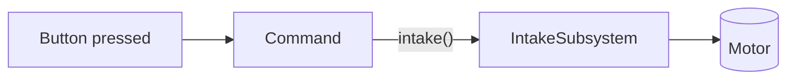

# Subsystems

A __subsystem__ is one mechanism on the robot: the drivetrain, the intake, the arm, the shooter. In code, each one is a class in its own file inside the `subsystems` folder, and it follows one rule:

!!! info "The subsystem rule"
    __Only the subsystem touches its own hardware.__ Nothing else on the robot calls its motors directly. Everyone else asks the subsystem to do something.

This is the same idea as `private` from the Java lessons. A `Car` keeps its `color` private and lets you change it through methods. A subsystem keeps its motors private and lets the rest of the robot use them through methods.



Why bother? Because when the intake spins the wrong way, there's exactly one file to look in. And because the scheduler can use the subsystem to make sure two commands never fight over the same motor. More on that below.

## What goes in a subsystem file

Every subsystem file has the same four parts. Here is one, with the parts labeled. You'll build this one in a moment.

```java title="IntakeSubsystem.java"
public class IntakeSubsystem extends SubsystemBase {          // (1)!

    private final SparkMax m_motor =                          // (2)!
        new SparkMax(IntakeConstants.kMotorId, MotorType.kBrushless);

    public IntakeSubsystem() {                                // (3)!
        // set up the motor here
    }

    public void intake() {                                    // (4)!
        m_motor.set(IntakeConstants.kIntakeSpeed);
    }

    public void stop() {
        m_motor.set(0.0);
    }

    @Override
    public void periodic() {                                  // (5)!
        SmartDashboard.putNumber("Intake speed", m_motor.get());
    }
}
```

1. `extends SubsystemBase` is what makes this class a subsystem. The scheduler now knows it exists.
2. The hardware, `private final`. Nothing outside this class can reach the motor.
3. The constructor runs once when the robot starts. This is where hardware gets configured.
4. Simple public methods describing what the mechanism can __do__. Keep them small and named for the action.
5. `periodic()` runs every 20 ms for you. It's the place for telemetry, meaning numbers you want to see on the dashboard.

## Build an intake

Time to run one. This robot has an intake, and the `RobotContainer` already connects the A button to it. __You don't need to understand `RobotContainer` yet__, because that's the next page. For now, focus on the subsystem.

Press __Run__, make sure the robot is in __teleop__, then press and hold the __A__ button on the virtual controller. The intake motor should spin, and the dashboard should show its speed.

```playground
//@ title: An intake subsystem
//@ panel: robot
//@ goal: Run it and hold A. Then change 0.8 to a different speed and restart. The motor reads its speed from the one line in intake().
//@ lines: 30
public class IntakeSubsystem extends SubsystemBase {
    private final SparkMax m_motor = new SparkMax(5, MotorType.kBrushless);

    public void intake() {
        m_motor.set(0.8);
    }

    public void stop() {
        m_motor.set(0.0);
    }

    @Override
    public void periodic() {
        SmartDashboard.putNumber("Intake speed", m_motor.get());
    }
}

public class RobotContainer {
    private final IntakeSubsystem m_intake = new IntakeSubsystem();
    private final CommandXboxController m_driver = new CommandXboxController(0);

    public RobotContainer() {
        configureBindings();
    }

    private void configureBindings() {
        // While A is held: intake. When released: stop.
        m_driver.a().whileTrue(
            m_intake.startEnd(() -> m_intake.intake(), () -> m_intake.stop()));
    }
}
```

Look at the __Scheduler__ section as you press and release the button. When you hold A, a command named `StartEndCommand` appears: it started when you pressed the button and ended when you let go. We'll look at how that's built in a moment.

### Challenge: add a method

The intake can only go one way. Real intakes also need to spit a game piece back out. Add an `outtake()` method that runs the motor backwards at half speed.

```playground
//@ title: Add outtake()
//@ prelude: wpilib
//@ goal: Add a public method called outtake() that sets the motor to -0.5.
//@ lines: 20
//@ require: void\s+outtake\s*\(\s*\) | Add a public void method named outtake() with no inputs.
public class IntakeSubsystem extends SubsystemBase {
    private final SparkMax m_motor = new SparkMax(5, MotorType.kBrushless);

    public void intake() {
        m_motor.set(0.8);
    }

    public void stop() {
        m_motor.set(0.0);
    }

    // Add outtake() here

}
//@@ harness
IntakeSubsystem intake = new IntakeSubsystem();
intake.intake();
System.out.println(Sim.getMotorOutput(5));
intake.outtake();
System.out.println(Sim.getMotorOutput(5));
intake.stop();
System.out.println(Sim.getMotorOutput(5));
//@@ expect
0.8
-0.5
0.0
//@@ hint
It looks just like `intake()` and `stop()`: `public void`, a name, empty parentheses, and braces.
//@@ hint
Inside the braces, call `m_motor.set(...)` with a negative number.
//@@ solution
public class IntakeSubsystem extends SubsystemBase {
    private final SparkMax m_motor = new SparkMax(5, MotorType.kBrushless);

    public void intake() {
        m_motor.set(0.8);
    }

    public void stop() {
        m_motor.set(0.0);
    }

    public void outtake() {
        m_motor.set(-0.5);
    }
}
//@@ explain
A negative speed spins the motor the other way. Notice that only the subsystem knows the motor's CAN id and speeds. The rest of the robot just says `outtake()`.
```

### Replace magic numbers with constants

`5`, `0.8` and `-0.5` are __magic numbers__: numbers sitting in code with no explanation. Change the CAN id and you'd have to hunt for every `5`. This is what `Constants.java` is for, as you saw on the [FRC Nuances](frcProgramming.md) page.

```playground
//@ title: Use constants
//@ prelude: wpilib
//@ goal: Replace the three magic numbers in IntakeSubsystem with the constants from IntakeConstants.
//@ lines: 28
//@ require: new SparkMax\(\s*(Constants\.)?IntakeConstants\.kMotorId | Use IntakeConstants.kMotorId for the motor id.
//@ require: set\(\s*(Constants\.)?IntakeConstants\.kIntakeSpeed | Use IntakeConstants.kIntakeSpeed in intake().
//@ require: set\(\s*(Constants\.)?IntakeConstants\.kOuttakeSpeed | Use IntakeConstants.kOuttakeSpeed in outtake().
public class Constants {
    public static class IntakeConstants {
        public static final int kMotorId = 5;
        public static final double kIntakeSpeed = 0.8;
        public static final double kOuttakeSpeed = -0.5;
    }
}

public class IntakeSubsystem extends SubsystemBase {
    private final SparkMax m_motor = new SparkMax(5, MotorType.kBrushless);

    public void intake() {
        m_motor.set(0.8);
    }

    public void outtake() {
        m_motor.set(-0.5);
    }
}
//@@ harness
IntakeSubsystem intake = new IntakeSubsystem();
intake.intake();
System.out.println(Sim.getMotorOutput(Constants.IntakeConstants.kMotorId));
intake.outtake();
System.out.println(Sim.getMotorOutput(Constants.IntakeConstants.kMotorId));
//@@ expect
0.8
-0.5
//@@ hint
A constant is reached through its class names, like `Constants.IntakeConstants.kMotorId`. Swap each number for the matching constant.
//@@ solution
public class Constants {
    public static class IntakeConstants {
        public static final int kMotorId = 5;
        public static final double kIntakeSpeed = 0.8;
        public static final double kOuttakeSpeed = -0.5;
    }
}

public class IntakeSubsystem extends SubsystemBase {
    private final SparkMax m_motor = new SparkMax(Constants.IntakeConstants.kMotorId, MotorType.kBrushless);

    public void intake() {
        m_motor.set(Constants.IntakeConstants.kIntakeSpeed);
    }

    public void outtake() {
        m_motor.set(Constants.IntakeConstants.kOuttakeSpeed);
    }
}
//@@ explain
Now the numbers live in one file. In a real project you'd add `import static frc.robot.Constants.IntakeConstants.*;` or `import frc.robot.Constants.IntakeConstants;` and write `IntakeConstants.kMotorId`.
```

## Command factories

So far, a subsystem exposes methods like `intake()` and `stop()`. But a button doesn't call a method. It schedules a __command__. A command is an action that the scheduler starts, runs, and ends, and a subsystem can build commands for itself using helper methods inherited from `SubsystemBase`:

| Helper | What the command does |
|---|---|
| `runOnce(() -> ...)` | Runs the code one time, then finishes. |
| `run(() -> ...)` | Runs the code every 20 ms until something cancels it. |
| `startEnd(() -> start, () -> end)` | Runs `start` once when it begins, and `end` once when it's cancelled. |
| `runEnd(() -> run, () -> end)` | Runs `run` every 20 ms, and `end` once when it's cancelled. |

These are the lambdas from the last page doing their job. You hand the scheduler "do this later," and it decides when.

It's common to have the subsystem return ready-made commands. That keeps `RobotContainer` short and easy to read:

```java
public Command intakeCommand() {
    return startEnd(() -> intake(), () -> stop());
}
```

Try it. This challenge makes the command for you to finish. The test schedules your command, lets it run, then cancels it, like a driver pressing and releasing a button.

```playground
//@ title: Write a command factory
//@ prelude: wpilib
//@ goal: Finish intakeCommand() so it runs intake() while the command is active and calls stop() when it ends.
//@ lines: 22
//@ require: startEnd | Use startEnd(...) to build the command.
public class IntakeSubsystem extends SubsystemBase {
    private final SparkMax m_motor = new SparkMax(5, MotorType.kBrushless);

    public void intake() {
        m_motor.set(0.8);
    }

    public void stop() {
        m_motor.set(0.0);
    }

    public Command intakeCommand() {
        // return a command here
        return null;
    }
}
//@@ harness
IntakeSubsystem intake = new IntakeSubsystem();
Command cmd = intake.intakeCommand();
cmd.schedule();
Sim.loops(3);
System.out.println("running: " + Sim.getMotorOutput(5));
cmd.cancel();
Sim.loops(1);
System.out.println("after cancel: " + Sim.getMotorOutput(5));
//@@ expect
running: 0.8
after cancel: 0.0
//@@ hint
`startEnd` takes two lambdas. The first runs at the start, and the second runs when the command ends.
//@@ hint
`return startEnd(() -> intake(), () -> stop());`
//@@ solution
public class IntakeSubsystem extends SubsystemBase {
    private final SparkMax m_motor = new SparkMax(5, MotorType.kBrushless);

    public void intake() {
        m_motor.set(0.8);
    }

    public void stop() {
        m_motor.set(0.0);
    }

    public Command intakeCommand() {
        return startEnd(() -> intake(), () -> stop());
    }
}
//@@ explain
The motor starts when the command starts and stops when it's cancelled, so even if something unexpected interrupts it, the intake never gets left running. That safety is why `startEnd` is so popular for held buttons.
```

## One command per subsystem at a time

Each command declares which subsystems it __requires__. The helper methods above automatically require the subsystem that built them. The scheduler follows one rule: __only one command can use a subsystem at a time__. If a second command that requires the same subsystem starts, the first is interrupted.

That's the safety net that stops two commands from fighting over a motor. See if you can predict what happens.

```playground
//@ title: Two commands, one intake
//@ mode: predict
//@ prelude: wpilib
//@ goal: What do the three lines print?
//@ lines: 21
public class Intake extends SubsystemBase {
    private final SparkMax m_motor = new SparkMax(5, MotorType.kBrushless);
    public void spin(double speed) { m_motor.set(speed); }
}

Intake intake = new Intake();
Command forward = intake.startEnd(() -> intake.spin(0.8), () -> intake.spin(0.0));
Command backward = intake.startEnd(() -> intake.spin(-0.5), () -> intake.spin(0.0));

forward.schedule();
Sim.loops(1);
System.out.println("motor: " + Sim.getMotorOutput(5));

backward.schedule();
Sim.loops(1);
System.out.println("motor: " + Sim.getMotorOutput(5));
System.out.println("forward still running? " + forward.isScheduled());
//@@ explain
Both commands require the same subsystem, so scheduling `backward` cancels `forward` first. The motor ends up at -0.5 (from `backward`), and `forward` is no longer scheduled.
```

## Reading sensors in a subsystem

Subsystems also own the __sensors__ for their mechanism, such as limit switches and encoders. They expose what the sensor sees through methods that return values. Try the intake below. It has a break-beam sensor on digital port 0 that detects when a game piece is inside. Flip the sensor switch in the panel to simulate a game piece arriving, and watch the intake stop on its own.

```playground
//@ title: An intake with a sensor
//@ panel: robot
//@ dio: 0
//@ goal: Run it and hold A. The intake spins until you flip the DIO 0 switch (a game piece breaks the beam), then it stops. Release A and hold it again with the sensor still on: the intake won't start.
//@ lines: 38
public class IntakeSubsystem extends SubsystemBase {
    private final SparkMax m_motor = new SparkMax(5, MotorType.kBrushless);
    private final DigitalInput m_beamBreak = new DigitalInput(0);

    public boolean hasPiece() {
        return m_beamBreak.get();
    }

    public Command intakeCommand() {
        return runEnd(
            () -> {
                if (hasPiece()) {
                    m_motor.set(0.0);
                } else {
                    m_motor.set(0.8);
                }
            },
            () -> m_motor.set(0.0));
    }

    @Override
    public void periodic() {
        SmartDashboard.putBoolean("Has piece", hasPiece());
        SmartDashboard.putNumber("Intake speed", m_motor.get());
    }
}

public class RobotContainer {
    private final IntakeSubsystem m_intake = new IntakeSubsystem();
    private final CommandXboxController m_driver = new CommandXboxController(0);

    public RobotContainer() {
        m_driver.a().whileTrue(m_intake.intakeCommand());
    }
}
```

!!! warning "Why `m_beamBreak.get()` and not `!`"
    On real hardware, many digital sensors read __false__ when triggered, so you'll often see `!m_beamBreak.get()`. Check how your sensor is wired. The simulator reads `true` when the switch is on.

## On a real robot

The classes in this page's editors have the same names as the real ones, but a real subsystem file starts with `package` and `import` lines and usually configures its motor. Here is what the real thing looks like with a REV SPARK MAX, using the 2025+ REVLib API:

```java title="IntakeSubsystem.java (real robot)"
package frc.robot.subsystems;

import static frc.robot.Constants.IntakeConstants.*;

import com.revrobotics.spark.SparkBase.PersistMode;
import com.revrobotics.spark.SparkBase.ResetMode;
import com.revrobotics.spark.SparkLowLevel.MotorType;
import com.revrobotics.spark.SparkMax;
import com.revrobotics.spark.config.SparkBaseConfig.IdleMode;
import com.revrobotics.spark.config.SparkMaxConfig;
import edu.wpi.first.wpilibj.smartdashboard.SmartDashboard;
import edu.wpi.first.wpilibj2.command.Command;
import edu.wpi.first.wpilibj2.command.SubsystemBase;

public class IntakeSubsystem extends SubsystemBase {
    private final SparkMax m_motor = new SparkMax(kMotorId, MotorType.kBrushless);

    public IntakeSubsystem() {
        SparkMaxConfig config = new SparkMaxConfig();
        config.inverted(false)
              .idleMode(IdleMode.kBrake)
              .smartCurrentLimit(40);
        m_motor.configure(config, ResetMode.kResetSafeParameters, PersistMode.kPersistParameters);
    }

    public Command intakeCommand() {
        return startEnd(() -> m_motor.set(kIntakeSpeed), () -> m_motor.set(0.0));
    }

    @Override
    public void periodic() {
        SmartDashboard.putNumber("Intake speed", m_motor.get());
    }
}
```

!!! note "Vendor libraries change"
    REV rewrote its Java API for the 2025 season, and CTRE (Phoenix 6) has its own style for Talon FX and Kraken motors. If your team uses a different motor controller or library version, the structure above stays exactly the same. The imports and the setup lines in the constructor are what change. Ask a mentor which library your robot uses.

```quiz
@ title: Subsystems
? What is the "subsystem rule"?
- Every subsystem must have exactly one motor
+ Only the subsystem touches its own hardware
- Subsystems can't have constructors
- A subsystem can only run one line of code per loop
> Everyone else on the robot asks the subsystem to do things. They never reach into the motors.

? Where should the numbers like the intake's CAN id live?
- Directly inside `Robot.java`
+ In `Constants.java`
- In every file that uses them
- In `Main.java`
> One place makes it easy to find and change them, and avoids typos from copying a number around.

? You want a command that runs the intake for as long as a button is held, and stops it on release. Which helper fits best?
- `runOnce`
- `run`
+ `startEnd`
- `Commands.none()`
> `startEnd` starts something and guarantees the end action runs when the command is cancelled.

? Two commands both require `IntakeSubsystem`. The first is running, and then the second is scheduled. What happens?
- Both run at the same time
+ The first is cancelled, then the second runs
- The second is ignored
- The robot crashes
> The scheduler never lets two commands use one subsystem at once, and by default the newer one wins.

? When is a subsystem's `periodic()` method called?
- Whenever you call it from a button binding
- Only in teleop
+ Every 20 ms, automatically
- Once at startup
> `SubsystemBase` registers the subsystem with the scheduler, which calls `periodic()` on every loop.

? What is a __magic number__? (Pick all that apply.)
+ A number written directly in code with no name explaining it
+ Something better replaced with a constant like `kIntakeSpeed`
- A number that is always 7
- A number the compiler picks for you
> Naming your numbers makes code readable and gives you one place to change them.
```

---

## What's next

You can now build a subsystem and give it commands. Next, learn how the [RobotContainer](robotContainer.md) creates your subsystems and decides which buttons make them move.
